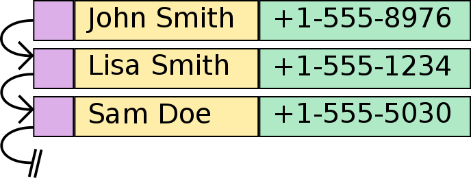

# Dictionary and Map ADTs

---

# Overview

- Identify keys, values, and entries.
- Describe dictionary operations and unique-key behavior.
- Use Java's Map and Set interfaces.
- Compare array and linked-node implementation options.

---

# Dictionary/Map ADT

- A dictionary associates a **key** with a **value**.
- A key lets us look up its associated value.
- One key-value pair is called an **entry**.
- In this lecture, dictionary and map describe the same ADT.

Example: student ID -> student record

---

# What is it?



- Key: a person's name; value: a phone number.
- A printed dictionary uses words as keys and definitions as values.

---

# A Familiar Dictionary


Look up a word to retrieve its definition.

The key tells us **what to find**; the implementation determines **how to find it**.

---

# Access by Key, Rather Than Position

- A list uses a position: "Give me the item at index 3."
- A dictionary uses a key: "Give me the student with ID 700000001."
- Keys do not need to be consecutive integers.
- The dictionary ADT does not require a particular iteration order.

---

# ADT vs. Storage Structure

- Linear structures organize elements in a sequence.
- A dictionary describes associations between keys and values.
- Its implementation may still store entries in an array or linked list.
- Calling dictionaries "non-linear" does not tell us how entries are physically stored.

---

# Dictionary ADT Overview

Data:

- Entries containing a key and a value
- Unique keys; values may repeat

Core operations:

- Insert or update an association
- Remove an association by key
- Search for a value by key

---

# Operations + Parameters

| Abstract operation | Meaning |
|---|---|
| insert(key, value) | Associate a value with a key |
| remove(key) | Remove the entry for that key |
| search(key) | Retrieve the value for that key |

The ADT contract must define what happens for an existing key or a missing key.

Java Map uses put to insert a new entry or replace an existing value.

---

# How Could This Be Implemented?

- An array of key-value entries
- A linked list whose nodes each contain a key and a value
- Variations using circular arrays, singly linked lists, or doubly linked lists

Starting point: search through entries and compare their keys.

Question: Does using an array automatically make lookup by key O(1)?

---

# Discussion/Demo of Array Implementation

Assume an unsorted array of entries with unique keys.

- Search: scan keys until a match is found ? O(n) worst case.
- Insert/update: check for an existing key before appending ? O(n).
- Remove: find the key, then fill the gap or shift entries ? O(n).
- Space: allocated capacity may exceed the number of entries.

Demo: insert two entries, update one key, then remove the other.

---

# Discussion/Demo of Linked List Implementation

Assume an unsorted singly linked list of entries with unique keys.

- Search: traverse nodes and compare keys ? O(n) worst case.
- Insert/update: finding an existing key takes O(n); adding at the head takes O(1).
- Remove: locating the node and its predecessor takes O(n); unlinking takes O(1).
- Space: each node stores an entry and a link; no unused array slots.

Question: Why does fast insertion at the head not make the entire insert/update operation O(1)?

---

# Associative Array

- In a regular array, an integer index identifies a position.
- An associative array uses a key to identify a value.
- "Associative array" is another name for a dictionary/map.
- The name does not require an array-based implementation.

Java arrays use integer indices; Java maps use methods such as put and get.

---

# DTCC Student Information System

A direct-address array could use student IDs as indices:

```java
// Conceptual example: studentNames is a String[].
studentNames[700000000] = "John Smith";
studentNames[700000001] = "Jane Doe";
```

- These indices require at least 700,000,002 array slots.
- Indexed access is O(1), but most slots might be unused.
- A map lets us store entries for the IDs that are present.

---

# Java Map and HashMap

```java
import java.util.Map;
import java.util.HashMap;

Map<Integer, String> students = new HashMap<>();
students.put(700000000, "John Smith");
students.put(700000001, "Jane Doe");
```

- Map<K, V> is the interface; HashMap<K, V> is one implementation.
- Integer is the key type; String is the value type.
- Generics use reference types, so we use Integer rather than int.

<!-- footer -->
https://docs.oracle.com/javase/8/docs/api/java/util/Map.html

https://docs.oracle.com/javase/8/docs/api/java/util/HashMap.html

---

# Operations in Java

```java
students.put(700000001, "Jane Smith"); // Replace this key's value.
String name = students.get(700000001); // "Jane Smith"
boolean found = students.containsKey(700000001); // true
String removed = students.remove(700000000); // "John Smith"
```

- put returns the previous value, or null if there was no mapping.
- get and remove return null for a missing key.
- A stored null value can make get ambiguous; containsKey checks whether the key exists.

---

# Other Helpful Map Operations

| Method | Purpose |
|---|---|
| size(), isEmpty() | Check the number of entries |
| keySet() | Access the unique keys |
| values() | Access the values, which may repeat |
| entrySet() | Access key-value pairs |
| forEach(...) | Perform an action on each entry |

Also available: putAll(...) copies mappings; replaceAll(...) updates values.

<!-- footer -->
https://docs.oracle.com/javase/8/docs/api/java/util/Map.html

---

# Set Interface

A map's keys form a set because keys are unique.

```java
java.util.Set<Integer> ids = students.keySet();
Integer[] idArray = ids.toArray(new Integer[0]);
```

- keySet() returns a view backed by the map.
- Changes to the map are reflected in the view.
- toArray(...) creates a separate array containing the current keys.

<!-- footer -->
https://docs.oracle.com/javase/8/docs/api/java/util/Set.html

---

# What Is a Set?

- A collection that contains no duplicate elements.
- The Set interface does not guarantee an iteration order.
- Specific implementations may provide ordering guarantees.

For a map:

- Two entries cannot have equal keys.
- Different keys may have equal values.

Example: two different student IDs may both map to "Alex Lee".

---

# Dictionary Implementations

The same operations can be supported by different storage structures.

| Implementation | Finding a key | Storage consideration |
|---|---|---|
| Unsorted array | Scan entries | Capacity and resizing |
| Unsorted linked list | Traverse nodes | Links stored with each node |
| Hash table | Use a hash function | Collisions and unused capacity |

Next lecture: how can a hash table improve average lookup time?

---

# Summary

- A dictionary associates unique keys with values; values may repeat.
- Core operations insert/update, remove, and search by key.
- Java Map defines the interface; HashMap provides an implementation.
- A map's keys form a set, with no ordering guaranteed by Set itself.
- Arrays and linked lists can implement dictionaries, but key lookup may require a scan.
