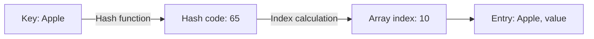
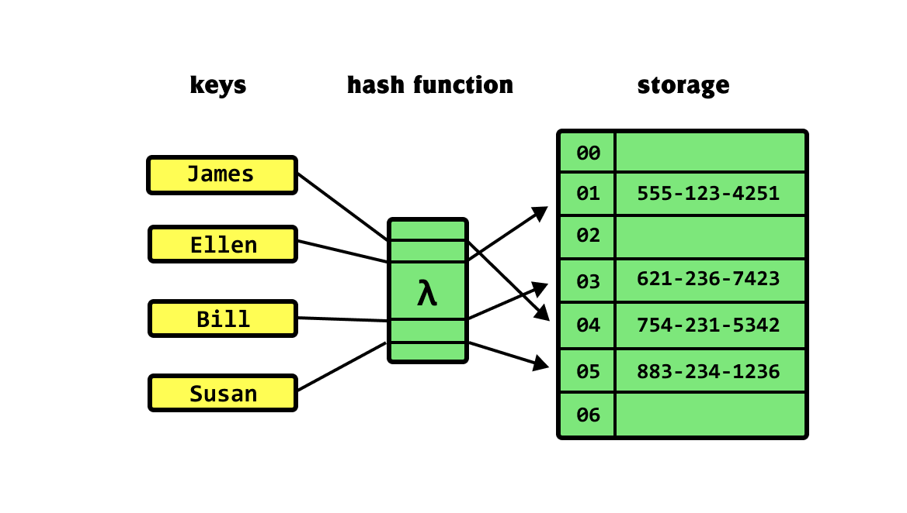

# Hash Tables and Hash Functions

---

# Overview

- Explain how a hash table stores dictionary entries.
- Distinguish a key, a hash code, and an array index.
- Apply Java's equals() and hashCode() contract.
- Evaluate simple hash functions and calculate example indices.

---

# From Dictionary ADT to Hash Table

- A dictionary defines operations on key-value pairs.
- A hash table is one implementation of that ADT.
- Goal: find an entry without scanning every stored key.

Recall: lookup in an unsorted array or linked list takes O(n) in the worst case.

---

# Hash Tables

- Use an array as the underlying storage.
- Compute a starting location from the key.
- Store both the key and value so we can check for a matching key.
- Use a hash function and an index calculation to select that location.

---

# This Is Still an Array!

One option is to use parallel arrays:

```java
int tableSize = 11;
String[] keys = new String[tableSize];
String[] values = new String[tableSize];
```

- keys[i] and values[i] describe the same entry.
- Valid indices are 0 through tableSize - 1.
- Another option: store entry objects in a single array.

---

# Entry Example

```java
class Entry {
    String key;
    String value;
}

Entry[] table = new Entry[11];
```

- Concrete types keep this storage example simple.
- Each occupied slot refers to an Entry containing a key and a value.
- Creating the array creates null slots; it does not create Entry objects.

---

# Associative Array

The key helps determine where its value is stored.



Example: first-character hash with a table size of 11.

- A hash function maps a key to an integer called a hash code.
- Index calculation reduces that integer to the table's valid range.
- During lookup, compare stored keys using equals() to confirm a match.

---

# Hash Functions

A good hash function combines two goals:

- The same key must lead us back to the same starting location.
- Different keys should spread across the available locations.

The first goal supports correctness; the second supports efficiency.

---

# Hash Function

```text
Key -> Hash Function -> Integer Index
```



---

# Guidelines for Hash Functions

- Be fast enough for frequent lookups and updates.
- Use the information that defines key equality.
- Distribute expected keys across the table.
- Avoid depending on properties that change while a key is stored.

A function can satisfy the equality contract and still distribute keys poorly.

---

# Java hashCode() Contract

- Equal objects according to equals() must have equal hash codes.
- Repeated calls during one execution must agree while the information used by equals() is unchanged.
- Hash codes do not have to stay the same between program runs.
- When overriding equals(), also override hashCode() consistently.

<!-- footer -->
https://docs.oracle.com/javase/8/docs/api/java/lang/Object.html#hashCode--

---

# Exploring Our Own Hash Functions

- Java objects have hashCode() and toString() methods inherited from Object or overridden by a class.
- We will use non-empty String keys for the following experiments.
- Character values let us construct simple teaching examples.

Goal: identify weaknesses before improving the function.

---

# Should We Hash toString()?

- toString() produces a textual representation, usually for people to read.
- It is not a general replacement for a key's equality definition.
- Equal custom objects could produce different text representations.
- For a String key, use the string directly; calling toString() adds nothing.

For general Java keys, use a hashCode() implementation consistent with equals().

---

# Basic Hash Function

```java
String key = "Apple"; // Assume a non-empty string.
int tableSize = 11;
int hash = key.charAt(0);
int index = hash % tableSize; // 65 % 11 = 10
```

| Character | Numeric value |
|---|---|
| A | 65 |
| B | 66 |
| C | 67 |
| D | 68 |

Weakness: only the first character influences the result; the remaining characters are ignored.

---

# Using More Characters

```java
String key = "Apple"; // Assume at least two characters.
int tableSize = 11;
int hash = key.charAt(0) + key.charAt(1);
int index = hash % tableSize; // (65 + 112) % 11 = 1
```

- Uses more of the key than the first-character method.
- Still ignores every character after the second.
- Addition ignores character order.

More characters do not automatically guarantee good distribution.

---

# Brainstorm Improvements

- How could we use every character?
- How could character position affect the result?
- How should empty strings be handled?
- Which test keys would expose a weak function?

Try: repeated prefixes, anagrams, short strings, and similar student IDs.

---

# Multiplication Method

For a nonnegative integer key k and table size m:

1. Choose a constant A between 0 and 1.
2. Compute k * A.
3. Keep only its fractional part.
4. Multiply that fraction by m and round down.

```text
index = floor(m * fractionalPart(k * A))
```

The fractional part keeps the scaled result within the table's range.

---

# Multiplication Method Example

```java
int key = 177;
int tableSize = 100;
double A = 0.6180339887;

double product = key * A;                  // About 109.392016
double fraction = product - Math.floor(product); // About 0.392016
int index = (int) (fraction * tableSize);  // 39
```

Scale the fractional part, rather than the full product.

This example uses a nonnegative integer key; floating-point precision limits apply for large inputs.

---

# Mid-Square Method

- Start with a nonnegative integer key.
- Square the key.
- Extract a chosen group of middle digits.
- Reduce the extracted number to the table's index range if needed.

Define a consistent digit width and extraction rule before using this method for many keys.

---

# Mid-Square Method Example

```java
int key = 177;
int tableSize = 100;
long squared = (long) key * key; // 31329
String digits = String.valueOf(squared);
String middle = digits.substring(1, 4); // "132"
int index = Integer.parseInt(middle) % tableSize; // 32
```

- substring(1, 4) includes positions 1, 2, and 3.
- These extraction positions are specific to this five-digit example.
- A general implementation needs rules for shorter or longer squares.

---

# Bit Shift Methods

```java
int num = 10;      // 00001010 (showing the lowest 8 bits)
num = num << 1;   // 20
num = num << 2;   // 80
num = num >>> 2;  // 20
num = num >> 2;   // 5
```

- << shifts left; overflow can discard high bits.
- >> shifts right and preserves the sign; >>> fills with zeros.
- For example, -8 >> 1 is -4, but -8 >>> 1 is 2147483644.
- Hash functions may combine shifts with XOR to mix bits; shifting alone does not ensure good distribution.

---

# Prime Numbers and Table Size

For the division method:

```java
int index = Math.floorMod(hash, tableSize);
```

- Patterns in hash values can interact with the table size.
- A prime table size can help avoid some shared-factor patterns.
- A prime size does not make an otherwise poor hash function effective.

---

# Why Primes Can Help

Suppose hash values are multiples of 10:

| Hash | Index with size 10 | Index with size 11 |
|---|---|---|
| 10 | 0 | 10 |
| 20 | 0 | 9 |
| 30 | 0 | 8 |
| 40 | 0 | 7 |

- Sizes 10 and 11 behave differently for this input pattern.
- Prime sizes are useful in some designs; other designs use powers of two with additional bit mixing.
- Table size and hash-function design must work together.

---

# Check Your Understanding

- With table size 11, where do hash codes 15, 27, and -8 map using floorMod?
- What must be true of the hash codes of two equal keys?
- Why does hashing only the first character work poorly for similar names?
- How does table size affect the valid range of indices?

---

# Summary

- A hash table uses keys to compute starting locations in an array.
- Hash codes must be reduced to valid array indices.
- Equal keys must have equal hash codes.
- Good hash functions are consistent, fast, and distribute keys across the table.
- Index calculations and table size work together to determine storage locations.
