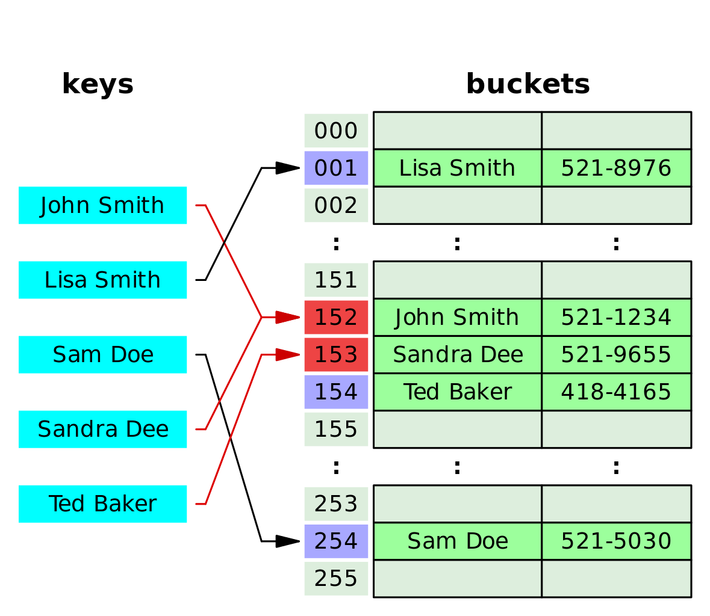

# Closed Hashing and Probing

---

# Overview

- Recognize collisions and distinguish keys using equals().
- Trace linear probing, including wraparound.
- Search, update, and delete without breaking a probe sequence.
- Explain clustering and table capacity.
- Compare quadratic probing and double hashing.
- Connect probing to expected and amortized operation costs.

---

# Equal Hash Codes Do Not Prove Equality

```java
String a = "FB";
String b = "Ea";
// a.equals(b) is false.
// Both strings have hashCode() == 2236.
```

- Unequal keys are allowed to share a hash code.
- Compare keys using equals() after locating a candidate entry.
- Avoid modifying fields used by equals()/hashCode() while a key is stored.

<!-- footer -->
https://docs.oracle.com/javase/8/docs/api/java/lang/Object.html#hashCode--

---

# Collisions

A table collision occurs when different keys map to the same array index.

- Equal hash codes produce the same index in our example.
- Different hash codes can also produce the same index.
- With table size 10: 15 % 10 = 5 and 25 % 10 = 5.
- More possible keys than slots means collisions cannot always be avoided.

Good distribution reduces collisions; it does not eliminate them.

---

# First-Letter Hash: A Concrete Example

Use a table of size 10 and insert these keys in the order shown.

```java
int index = key.charAt(0) % 10;
```

| Key | First-character value | index |
|---|---|---|
| Apple | A = 65 | 5 |
| Apricot | A = 65 | 5 |
| Avocado | A = 65 | 5 |
| Banana | B = 66 | 6 |
| Blueberry | B = 66 | 6 |
| Blackberry | B = 66 | 6 |

---

# Using the First Two Letters

Add the character values, then reduce to the table's range.

```java
int index = (key.charAt(0) + key.charAt(1)) % 10;
```

| Key | Character-value sum | index |
|---|---|---|
| Apple | 65 + 112 = 177 | 7 |
| Apricot | 65 + 112 = 177 | 7 |
| Avocado | 65 + 118 = 183 | 3 |
| Banana | 66 + 97 = 163 | 3 |
| Blueberry | 66 + 108 = 174 | 4 |
| Blackberry | 66 + 108 = 174 | 4 |

---

# What Are We Counting as a Collision?

For this comparison, count one collision whenever a key's starting index has already been produced by an earlier key.

- First letter: Apricot, Avocado, Blueberry, and Blackberry repeat an index: **4 collisions**.
- First two letters: Apricot, Banana, and Blackberry repeat an index: **3 collisions**.
- Avocado and Banana have different sums, but both map to index 3 after % 10.
- Using more characters improved this example, but did not eliminate collisions.

These counts describe repeated starting indices, before resolving collisions. They do not count every occupied slot examined during probing.

Next question: where should we store a key when its starting slot is occupied?

---

# Closed Hashing: Entries Stay in the Table

- Store entries directly in the table's array slots.
- Each slot holds at most one active entry.
- If the starting slot is occupied by another key, follow a **probe sequence** to examine other slots.
- The stored key lets us distinguish an existing mapping from a different key.

Also called **open addressing**. Despite that name, it is the strategy we call closed hashing here.

---

# Closed Hashing: Probing Within the Array

<!-- image bg="#ffffff" -->


The hash selects the starting slot; probing determines where a displaced entry goes.

---

# Linear Probing

Examine consecutive slots, wrapping around at the array's end.

```java
int index = start;
// After examining a slot:
index = (index + 1) % tableSize;
```

- For table size 10 and start 9: **9, 0, 1, 2, ... , 8**.
- A **probe** is one slot examination, including the starting slot.
- Stop after at most tableSize probes; never loop indefinitely.

---

# Insert the Fruit Keys with Linear Probing

Use the first-letter hash and the same insertion order as before. Begin with an empty table of size 10.

| Key | Start | Slots examined | Stored at | Probes |
|---|---|---|---|---|
| Apple | 5 | 5 | 5 | 1 |
| Apricot | 5 | 5, 6 | 6 | 2 |
| Avocado | 5 | 5, 6, 7 | 7 | 3 |
| Banana | 6 | 6, 7, 8 | 8 | 3 |
| Blueberry | 6 | 6, 7, 8, 9 | 9 | 4 |
| Blackberry | 6 | 6, 7, 8, 9, 0 | 0 | 5 |

---

# Searching Follows the Same Path

To find Blueberry, recompute its starting index: 66 % 10 = 6.

| Probe | Index | Stored key | Action |
|---|---|---|---|
| 1 | 6 | Apricot | Different key; continue |
| 2 | 7 | Avocado | Different key; continue |
| 3 | 8 | Banana | Different key; continue |
| 4 | 9 | Blueberry | Match; return its value |

- Use equals() to compare keys, not just hash codes.
- An entry's actual location may differ from its starting index.

---

# When Does a Search Stop?

- **Matching key:** return the associated value.
- **Never-used empty slot:** the key is absent; stop.
- **Deleted slot:** keep searching; the key may be farther along.
- **Probe limit reached:** report that the key is absent.

Example: search for Bilberry, starting at 6. Examine indices 6, 7, 8, 9, and 0, then find the never-used slot at 1: absent after **6 probes**.


> These rules assume deletion uses **tombstones**, as explained below. The stopping rule must agree with how remove() handles a vacated slot.  More on this later!

---

# Inserting or Updating a Key

- Follow the same probe sequence used for searches.
- If the key already exists, replace its value rather than adding a duplicate.
- If no matching key exists, insert into an available slot.
- If the sequence has no available slot, grow and rehash or report insertion failure.

After deletions, remember the first deleted slot, but continue checking for an existing key before reusing it.

---

# Why Deletion Needs Care

Suppose we remove Apricot from index 6 in our fruit table.

- Blueberry is still stored at index 9, but its search starts at 6.
- If index 6 becomes an ordinary empty slot, the search stops too early.
- The entry exists, yet the search incorrectly reports it missing.

We must preserve the path that later searches follow. Simply setting a slot to null is unsafe if searches stop at null and displaced entries remain beyond that slot.

---

# Search and Remove Must Agree

There is more than one valid deletion strategy:

| Strategy | What remove() does | What search() must do |
|---|---|---|
| Tombstones | Mark the slot deleted; leave other entries in place | Continue past deleted slots; stop at never-used slots |
| Repair the cluster (linear probing) | Clear the slot, then reinsert the following run of entries | Stop at an empty slot because removal restored valid search paths |
| Clear without repair | Leave a hole and keep displaced entries where they are | Cannot safely stop at that hole; may need to examine the full probe sequence |

We will use **tombstones** for the remaining examples. Clearing without repair sacrifices the early-stop benefit of an empty slot.

---

# Tombstones: Deleted Is Not Never Used

A **tombstone** marks a slot that previously held an entry.

| Slot state | During search | During insert/update |
|---|---|---|
| Occupied | Compare keys | Update if the key matches |
| Never used | Stop: absent | Insert if no reusable deleted slot was found |
| Deleted | Continue probing | Remember as a reusable slot; keep checking for the key |

Deleting Apricot leaves a tombstone at 6, so a search can still reach Blueberry at 9.

If the complete probe sequence is exhausted with no match, reuse a remembered tombstone if one exists. Periodic rebuilding clears accumulated tombstones.

---

# Alternative: Repair After Removal

For **linear probing**, one straightforward alternative is to reinsert the entries after the removed slot.

1. Remove Apricot from index 6.
2. Walk forward through the occupied run: 7, 8, 9, 0; stop at empty index 1.
3. Remove and reinsert each encountered entry using its original hash and normal linear probing.

| Entry | Before removal | After repair |
|---|---|---|
| Avocado | 7 | 6 |
| Banana | 8 | 7 |
| Blueberry | 9 | 8 |
| Blackberry | 0 | 9 |

Index 0 is now empty, and no remaining key needs to search beyond it. No tombstone is needed. Removal may do more work immediately; this consecutive-run repair does not directly generalize to quadratic probing or double hashing.

---

# Clustering

Linear probing can create long runs of occupied slots: **primary clustering**.

- Our fruit entries occupy 5, 6, 7, 8, 9, and 0: one cluster crossing the array boundary.
- A new key starting anywhere in that run must probe beyond it.
- Entries with different starting indices can join the same cluster.
- Larger clusters increase the number of probes for searches and insertions.

Question: Why did Banana need 3 probes even though it was the first key whose starting index was 6?

---

# Capacity and Load Factor

Let n be active entries and m be array capacity. **Load factor = n / m**.

- Our example: 6 / 10 = 0.60 (60%).
- At most m active entries fit in m slots.
- As the table fills, finding an available slot generally takes more probes.
- Tombstones also extend searches even though they are not active entries.

Capacity is fixed for one array allocation; a resizable implementation can allocate a larger array and rehash the entries.

---

# Other Probing Strategies

| Strategy | Candidate index for probe number i, starting at i = 0 |
|---|---|
| Linear | (start + i) % m |
| Quadratic example | (start + i * i) % m |
| Double hashing | (start + i * step) % m |

Use the same strategy for insertion, lookup, and deletion.

These formulas describe the probe sequences; Java implementations must also handle integer overflow safely.

---

# Quadratic Probing

Use square offsets from the original starting index.

For start 9 and m = 10:

| i | Offset i squared | Candidate index |
|---|---|---|
| 0 | 0 | 9 |
| 1 | 1 | 0 |
| 2 | 4 | 3 |
| 3 | 9 | 8 |
| 4 | 16 | 5 |

- Avoids the consecutive runs produced by linear probing.
- Keys with the same start still follow the same sequence.
- This sequence does not visit every slot; table size and load restrictions matter.

---

# Double Hashing

A second hash function determines a step size for each key.

Example: start 9, step 3, and m = 10:

**9, 2, 5, 8, 1, 4, 7, 0, 3, 6**

- Compute each candidate from (start + i * step) % m.
- Different keys sharing a start may have different steps.
- The step must be nonzero and relatively prime to m to visit every slot.
- With m = 10, use a step of 1, 3, 7, or 9. A step of 2 would visit only five slots.

<!-- footer -->
https://opendsa-server.cs.vt.edu/ODSA/Books/park-u/cs352-8c4e86db-183b-4e83-9e36-4b5e63f13d4a/spring-2024/Spring_1_DL/html/HashCImproved.html

---

# Repeatable Hashing Recreates the Search Path

- With the same key information, table size, and hash-function rules, we must get the same starting index and step size every time.
- Double hashing computes two values from the key: the starting index and the step. It does not mean hashing an unknown result again and hoping to find the entry.
- Insertion, search, and removal repeat those calculations to follow the same probe sequence.

For start 9, step 3, and table size 10, every operation follows:

**9, 2, 5, 8, 1, 4, 7, 0, 3, 6**

We **recompute the path from the key**; we do not reverse the hash to recover the key. If the table size changes, rehash the stored entries so their locations match the new calculations.

---

# Efficiency

Let n be the number of stored entries.

| Implementation | Lookup | Insert/update | Remove |
|---|---|---|---|
| Hash table, expected | O(1) | O(1) amortized | O(1) |
| Hash table, worst case | O(n) | O(n) | O(n) |
| Self-balancing search tree, worst case | O(log n) | O(log n) | O(log n) |
| Unsorted key-value list, worst case | O(n) | O(n) | O(n) |

Hash-table estimates assume good distribution and controlled load; hashing and key comparisons are treated as constant cost.

List insertion/update includes checking whether the key already exists.

---

# What Does O(1) Mean Here?

- Expected O(1): the expected number of entries examined stays bounded as n grows, under suitable hashing and load assumptions.
- Amortized O(1) insertion: occasional resizing is spread across many insertions.
- Neither claim guarantees that every operation takes the same time.
- Hashing a string may itself take O(L), where L is its length.

Question: How can one insertion cost O(n) while a sequence of insertions averages O(1) each?

---

# Check Your Understanding

Use the fruit table after deleting Apricot with a tombstone at index 6.

- Which slots does a search for Blackberry examine?
- Why must a search continue past index 6?
- When inserting Blueberry again, why should we not immediately use that tombstone?
- If a new key starts at 5, which available slot can it reuse after confirming that its key is absent?

---

# Summary

- Closed hashing stores entries in the array and resolves collisions by probing.
- Linear probing checks consecutive slots and wraps around.
- Searches must follow the insertion sequence and compare keys.
- Search stopping rules depend on the deletion strategy.
- Tombstones preserve search paths; linear probing can instead repair the cluster.
- Clustering and high load increase probe counts.
- Quadratic probing and double hashing change the probe sequence.
- Expected and amortized costs describe different aspects of performance.

Next lecture: separate chaining stores colliding entries outside the array slots.
