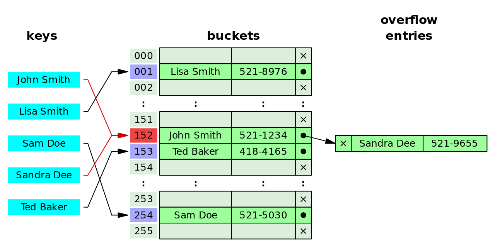
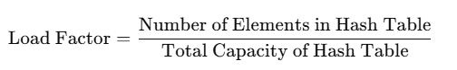

# Open Hashing and Separate Chaining

---

# Overview

- Separate chaining and collision handling
- Searches and deletions
- Rehashing, load factor, and performance comparisons

---

# Dealing with Collisions

Open hashing (chaining)

---

# Open Hashing (Separate Chaining)

If a collision occurs, store entries in linked lists.

---

# What about searches?

Searches must account for collisions and alternate storage locations.

---

# What about deletions?

Open hashing:
- Remove directly.

Closed hashing:
- Use tombstones.

---

# Rehashing

Resize and recompute indices to maintain efficiency.

---

# Process of Rehashing

1. Create larger table.
2. Recompute hashes.
3. Reinsert elements.
4. Update references.

---

# Load factor

The load factor measures how full a hash table is.

---

# Ideal load factor?

- Too high → more collisions.
- Too low → wasted memory.

---

# Rehash Thresholds

- Closed Hashing: > 0.5 or 0.75
- Open Hashing: can exceed 1.0

---

# Efficiency implications of collisions

Discussion:
- Open hashing pros/cons
- Closed hashing pros/cons
- Insert, Remove, Search runtime implications

---

# What about worst case scenarios?

- Heavy collisions push operations toward O(n).
- Applies to both open and closed hashing.

---

# Hash Table Size

- Perfect world: 1-to-1
- Real world: approximately 1.3x

---

# Resources

- https://www.cs.cornell.edu/courses/cs3110/2014fa/lectures/13/lec13.html
- https://www.cs.cornell.edu/courses/cs2112/2014fa/lectures/lecture.html?id=hashtables

---

# Summary

- Open hashing stores colliding entries in linked lists.
- Search and deletion must account for collision handling.
- Load factor and rehashing influence efficiency.
- Heavy collisions can push operations toward O(n).
