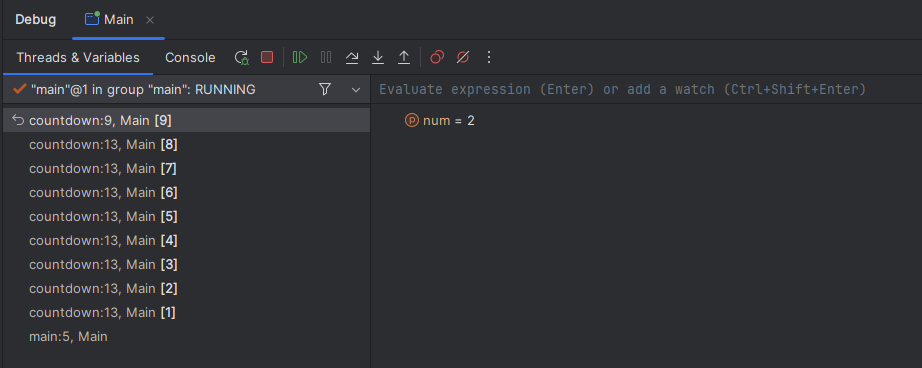

# Recursion Efficiency and Applications

---

# Overview

- Analyze time and stack space
- Compare recursion with iteration
- Explore recursive searches and data structure processing

---

# Efficiency Implications

- Time Complexity
- Space Complexity

---

# Time Complexity

- O(n)
- Same as iterative version

---

# The “Problem”

---

# Space complexity

- O(n)
- Requires extra stack space
- Iterative version is O(1)

---

# Recursion VS Iteration

| Recursion | Iteration |
|---|---|
| Ends with base case | Ends when condition fails |
| Uses functions | Uses loops |
| Extra stack memory | No extra stack memory |
| Smaller code size | Larger code size |

---

# Some more simple problems

- Count up
- Binary Search

---

# In our context: data structures

- Iterate through an array
- Iterate through a linked list

---

# Challenge

Head vs tail recursion

<!-- footer -->
https://dev.to/soorya54/head-recursion-vs-tail-recursion-22o3

---

# Summary

- Time and space costs depend on the calls made and maximum call depth
- The countdown and factorial examples use linear time and stack space
- Iteration can avoid the extra recursive call stack in these examples
- Recursive structure is useful when processing naturally recursive data
