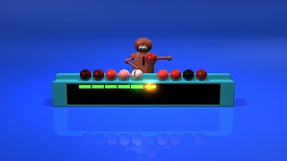

# Sorting Fundamentals and Simple Sorts

---

# Overview

- Compare sorting strategies through an activity
- Identify time, space, and stability tradeoffs
- Trace selection, bubble, and insertion sorts

---

# What is Sorting?

- Arrange elements in ascending or descending order
- Used for searching and data organization

Common algorithms:
- Bubble Sort
- Selection Sort
- Insertion Sort
- Shell Sort
- Merge Sort
- Quick Sort

---

# Why is Sorting Important?

- Enables Binary Search
- Organizes data
- Improves database indexing

---

# Sorting Activity

- Sort the cards
- Restriction: You are not allowed to put the cards down

---

# Sorting Activity

- Sort the cards
- You can put the cards down

---

# Sorting Activity

- Sort the cards
- Get someone to help you
- Restriction: You are not allowed to put the cards down

---

# Sorting Activity

- Sort the cards
- Get someone to help you
- You can put the cards down

---

# Reflection/Discussion

- How fast was each strategy?
- How much extra space was used?
- Every strategy has pros and cons

---

# Classification of Sorting Algorithms

- Time Complexity
- Space Complexity
- Stability
- Recursive vs Non-Recursive

---

# Sorting Time and Space Complexity Overview

| Algorithm | Best | Worst | Space | Notes |
|---|---|---|---|---|
| Selection | O(n²) | O(n²) | O(1) | In-place |
| Bubble | O(n) | O(n²) | O(1) | Nearly sorted |
| Insertion | O(n) | O(n²) | O(1) | Almost-sorted |
| Shell | O(n^1.5) approx | varies | O(1) | Gap-based |
| Merge | O(n log n) | O(n log n) | O(n) | Stable |
| Quick | O(n log n) | O(n²) | O(log n) | Pivot matters |
| Counting/Radix | O(n+k) | O(n+k) | O(n+k) | Restricted cases |

---

# Selection Sort

- Select smallest element
- Swap into correct position
- No extra space

---

# Selection Sort Code

```java
void selectionSort(int arr[]) {
    int n = arr.length;
    for (int i = 0; i < n - 1; i++) {
        int minIdx = i;
        for (int j = i + 1; j < n; j++) {
            if (arr[j] < arr[minIdx]) {
                minIdx = j;
            }
        }
        int temp = arr[minIdx];
        arr[minIdx] = arr[i];
        arr[i] = temp;
    }
}
```

---

# Key Components

- Runs
- Iterations
- Sorted vs unsorted sections
- Final resting place of elements

---

# Bubble Sort

- Swaps adjacent elements
- Simple but inefficient
- No extra space

---

# Bubble Sort Code

```java
void bubbleSort(int arr[]) {
    int n = arr.length;
    for (int i = 0; i < n - 1; i++) {
        for (int j = 0; j < n - i - 1; j++) {
            if (arr[j] > arr[j + 1]) {
                int temp = arr[j];
                arr[j] = arr[j + 1];
                arr[j + 1] = temp;
            }
        }
    }
}
```

---

# Insertion Sort

- Builds sorted section one item at a time
- Efficient for nearly sorted data
- No extra space

---

# Insertion Sort Code

```java
void insertionSort(int arr[]) {
    int n = arr.length;
    for (int i = 1; i < n; i++) {
        int key = arr[i];
        int j = i - 1;
        while (j >= 0 && arr[j] > key) {
            arr[j + 1] = arr[j];
            j--;
        }
        arr[j + 1] = key;
    }
}
```

---

# Insertion Sort vs Bubble Sort Video



---

# Summary

- Sorting organizes data and supports efficient searching
- Selection sort chooses the next smallest item
- Bubble sort exchanges out-of-order neighbors
- Insertion sort extends a sorted prefix
- Algorithm choices depend on input and resource tradeoffs
