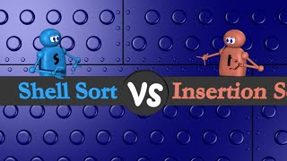

# Sorting Fundamentals: Simple Sorts and Shell Sort

---

# Overview

- Compare sorting strategies through an activity
- Identify time, space, and stability tradeoffs
- Trace selection, bubble, and insertion sorts
- Extend insertion sort using Shell sort's decreasing gaps

---

# What is Sorting?

- Arrange elements in ascending or descending order
- Used for searching and data organization

Common algorithms:
- Bubble Sort
- Selection Sort
- Insertion Sort
- Shell Sort
- Merge Sort
- Quick Sort

---

# Why is Sorting Important?

- Enables Binary Search
- Organizes data
- Improves database indexing

---

# Sorting Activity

- Sort the cards
- Restriction: You are not allowed to put the cards down

---

# Sorting Activity

- Sort the cards
- You can put the cards down

---

# Sorting Activity

- Sort the cards
- Get someone to help you
- Restriction: You are not allowed to put the cards down

---

# Sorting Activity

- Sort the cards
- Get someone to help you
- You can put the cards down

---

# Reflection/Discussion

- How fast was each strategy?
- How much extra space was used?
- Every strategy has pros and cons

---

# Classification of Sorting Algorithms

- Time Complexity
- Space Complexity
- Stability
- Recursive vs Non-Recursive

---

# Sorting Time and Space Complexity Overview

| Algorithm | Best | Worst | Space | Notes |
|---|---|---|---|---|
| Selection | O(n²) | O(n²) | O(1) | In-place |
| Bubble | O(n) with early exit | O(n²) | O(1) | Shown code has no early exit |
| Insertion | O(n) | O(n²) | O(1) | Almost-sorted |
| Shell | Gap-dependent | Gap-dependent | O(1) | Gap sequence matters |
| Merge | O(n log n) | O(n log n) | O(n) | Stable |
| Quick | O(n log n) | O(n²) | O(log n) typical; O(n) worst | Includes recursion stack |

Specialized sorts use different cost models; we will compare those separately.

---

# Reading the Sorting Tables

- **Across a row:** follow array positions or separate groups from left to right
- **Down the rows:** follow successive passes, iterations, or recursion levels, as labeled
- **Iteration:** one repetition of a loop; an outer pass usually contains several inner iterations
- **Sorted run:** a consecutive group already in order; it may still need merging or shifting

Table height counts the stages shown; row width and the work hidden inside each stage also matter.

---

# Selection Sort

- Select smallest element
- Swap into correct position
- Each pass grows a sorted section on the left

---

# Selection Sort Code

```java
void selectionSort(int arr[]) {
    int n = arr.length;
    for (int i = 0; i < n - 1; i++) {
        int minIdx = i;
        for (int j = i + 1; j < n; j++) {
            if (arr[j] < arr[minIdx]) {
                minIdx = j;
            }
        }
        int temp = arr[minIdx];
        arr[minIdx] = arr[i];
        arr[i] = temp;
    }
}
```

---

# Selection Sort: Passes Down, Positions Across

**Bold values are fixed in their final positions.** Each row follows a complete scan for the next minimum.

| After outer pass | 0 | 1 | 2 | 3 | 4 |
|---|---|---|---|---|---|
| Start | 5 | 2 | 4 | 1 | 3 |
| 1 | **1** | 2 | 4 | 5 | 3 |
| 2 | **1** | **2** | 4 | 5 | 3 |
| 3 | **1** | **2** | **3** | 5 | 4 |
| 4 | **1** | **2** | **3** | **4** | **5** |

- The sorted left section grows; the unsorted right section shrinks
- Inner comparisons per pass: 4 + 3 + 2 + 1; an unchanged row still costs work

---

# Selection Sort: Big Ideas

- **Sections:** a sorted section grows on the left; the unsorted section shrinks on the right
- **Final positions:** each pass fixes the next smallest value at the end of the sorted section; that section is finished, while unsorted values may still move
- **Comparisons:** finding the next minimum still requires scanning the remaining values
- **Movement:** at most one swap per pass, even if many comparisons are needed
- **Tradeoff:** O(1) extra space, but O(n²) time and no usual stability guarantee

---

# From Selection to Bubble Sort

- Selection sort searches the whole unsorted section before swapping
- What if we fix out-of-order neighbors as soon as we find them?
- Bubble sort makes that change: compare the work saved or added, not just the final result

---

# Bubble Sort

- Swaps adjacent elements
- Each pass moves the largest remaining value to the right end
- Repeat on the remaining unsorted section

---

# Bubble Sort Code

```java
void bubbleSort(int arr[]) {
    int n = arr.length;
    for (int i = 0; i < n - 1; i++) {
        for (int j = 0; j < n - i - 1; j++) {
            if (arr[j] > arr[j + 1]) {
                int temp = arr[j];
                arr[j] = arr[j + 1];
                arr[j + 1] = temp;
            }
        }
    }
}
```

---

# Bubble Sort: Passes Down, Positions Across

**Bold values are fixed in their final positions.** Within each row's pass, comparisons move left to right.

| After outer pass | 0 | 1 | 2 | 3 | 4 |
|---|---|---|---|---|---|
| Start | 5 | 2 | 4 | 1 | 3 |
| 1 | 2 | 4 | 1 | 3 | **5** |
| 2 | 2 | 1 | 3 | **4** | **5** |
| 3 | 1 | 2 | **3** | **4** | **5** |
| 4 | **1** | **2** | **3** | **4** | **5** |

- The sorted right section grows; each pass skips that finished section
- The shown code still performs the fourth pass, even though the third row is already sorted

---

# Bubble Sort: Big Ideas

- **Sections:** an unsorted section remains on the left; a sorted section grows on the right
- **Final positions:** each pass fixes the largest remaining value at the start of the sorted section; that section is finished, while unsorted values may still move
- **Movement:** a value may need many neighboring swaps to reach its position
- **Existing order:** an early-exit check can detect a pass with no swaps; the shown code does not include it
- **Tradeoff:** stable with strict comparisons and O(1) extra space, but O(n²) worst-case time

---

# Selection Sort vs Bubble Sort

| Difference | Selection Sort | Bubble Sort |
|---|---|---|
| Strategy | Find the smallest remaining value | Swap out-of-order neighbors |
| After each pass | Smallest remaining value is fixed on the left | Largest remaining value is fixed on the right |
| Swaps | At most one per pass | May swap many times per pass |
| Already sorted input | Still scans the remaining values | Can stop early with a no-swap check |

Both use O(1) extra space and take O(n²) time in the worst case.

---

# Choosing Selection Sort or Bubble Sort

- **Choose selection sort when swaps are expensive:** it makes at most one swap per pass
- **Choose bubble sort for already or nearly sorted data:** a no-swap check can end the sort early
- **Choose bubble sort when equal values must keep their original order:** swap only when the left value is larger; standard selection sort is not stable
- **For large datasets:** prefer a more efficient algorithm; both can require O(n²) work

---

# Beyond These Two Sorts

- **Neither scales well:** O(n²) work becomes costly as the dataset grows
- **Their comparison gives us a framework:** count comparisons, swaps, and extra storage—not just steps in the code
- **Input matters:** size, existing order, and the cost of moving values can change which approach works best
- **Use these questions for every sort:** Can it skip unnecessary work? Does it preserve equal-key order? What tradeoffs does it make?

---

# Insertion Sort

- Builds sorted section one item at a time
- Shift larger values right to make room for the next item
- Like placing a new card into an already-sorted hand

---

# Insertion Sort Code

```java
void insertionSort(int arr[]) {
    int n = arr.length;
    for (int i = 1; i < n; i++) {
        int key = arr[i];
        int j = i - 1;
        while (j >= 0 && arr[j] > key) {
            arr[j + 1] = arr[j];
            j--;
        }
        arr[j + 1] = key;
    }
}
```

---

# Insertion Sort: A Sorted Run That Can Still Move

**Bold marks the sorted prefix, not guaranteed final positions.** Each row inserts one more item.

| After insertion | 0 | 1 | 2 | 3 | 4 |
|---|---|---|---|---|---|
| Start | **5** | 2 | 4 | 1 | 3 |
| i = 1 | **2** | **5** | 4 | 1 | 3 |
| i = 2 | **2** | **4** | **5** | 1 | 3 |
| i = 3 | **1** | **2** | **4** | **5** | 3 |
| i = 4 | **1** | **2** | **3** | **4** | **5** |

- Watch 5 move right as the sorted prefix grows
- The inner loop shifts as many larger values as needed; one row is not one comparison

---

# Insertion Sort vs Bubble Sort Video


[Watch: Insertion Sort vs Bubble Sort](https://www.youtube.com/watch?v=TZRWRjq2CAg)

---

# Insertion Sort: Big Ideas

- **Small or nearly sorted input:** little work is needed to place each item
- **Growing input:** insert the next value into an already-sorted section
- **Sorted does not mean final:** the sorted section grows, but its values may shift again as new items are inserted; selection and bubble sort fix one more value in its final position each pass
- **Movement costs:** shifting can avoid repeated swaps, but still moves many values on difficult input
- **Know its limit:** reverse-sorted data requires many shifts; a larger dataset may need another strategy

---

# Comparing the Three Simple Sorts

| Question | Selection | Bubble | Insertion |
|---|---|---|---|
| How do values move? | One chosen value is swapped into place | Repeated neighbor swaps | Larger values shift to make room |
| Can existing order help? | Little benefit | Yes, with an early-exit check | Yes, fewer shifts are needed |
| Keeps equal-key order? | Usually not | Yes, with strict comparisons | Yes, with strict comparisons |

All three use O(1) extra space and have O(n²) worst-case time.

---

# From Insertion Sort to Shell Sort

- Insertion sort shifts larger values one position at a time
- A value far from its destination can require many shifts
- Shell sort first compares values farther apart, then finishes with ordinary insertion sort

---

# Shell Sort

- Extends insertion sort with a decreasing gap sequence
- Sorts groups of elements that are a gap apart
- Ends with gap 1: insertion sort on a mostly ordered array

---

# Shell Sort Code

```java
void shellSort(int arr[]) {
    int n = arr.length;
    for (int gap = n / 2; gap > 0; gap /= 2) {
        for (int i = gap; i < n; i++) {
            int temp = arr[i];
            int j;
            for (j = i; j >= gap && arr[j-gap] > temp; j -= gap) {
                arr[j] = arr[j-gap];
            }
            arr[j] = temp;
        }
    }
}
```

---

# Shell Sort: Gaps and Inner Iterations

The shown code uses gaps 3, then 1 for six items.

| Stage | 0 | 1 | 2 | 3 | 4 | 5 |
|---|---|---|---|---|---|---|
| Start | 6 | 5 | 4 | 3 | 2 | 1 |
| gap 3, i = 3 | 3 | 5 | 4 | 6 | 2 | 1 |
| gap 3, i = 4 | 3 | 2 | 4 | 6 | 5 | 1 |
| gap 3, i = 5 | 3 | 2 | 1 | 6 | 5 | 4 |
| gap 1, after all 5 insertions | 1 | 2 | 3 | 4 | 5 | 6 |

- Gap 3 orders the spaced groups (0, 3), (1, 4), and (2, 5)
- Two gap passes contain many iterations; the final row compresses five insertions

---

# Shell Sort vs Insertion Sort



[Watch: Shell Sort](https://www.youtube.com/watch?v=g06hNBhoS1k)

---

# Shell Sort: Big Ideas

- **Compared with insertion sort:** large gaps move misplaced values farther in one step
- **Memory stays small:** the array is rearranged in place
- **Performance depends on the gaps:** a different gap sequence changes the work required
- **Tradeoff:** long-distance moves can change the relative order of equal keys

---

# Summary

- Sorting organizes data and supports efficient searching
- Selection sort chooses the next smallest item
- Bubble sort exchanges out-of-order neighbors
- Insertion sort extends a sorted prefix
- Shell sort uses decreasing gaps to move values farther before a final insertion-sort pass
- Algorithm choices depend on input and resource tradeoffs

---

# Next: Divide the Work Differently

- These sorts improve order through repeated passes over the array
- Could sorting smaller pieces avoid repeatedly working through the whole unsorted section?
- Next, compare merge sort and quicksort: two ways to divide a problem into smaller sorting jobs
