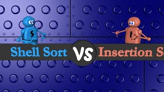
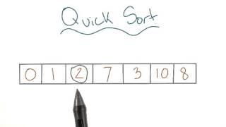

# Shell Sort, Merge Sort, and Quick Sort

---

# Overview

- Explore gap-based sorting
- Apply divide and conquer
- Compare merging with pivot-based partitioning

---

# Shell Sort

- Optimization of insertion sort
- Uses decreasing gap sequence
- Moves elements long distances

---

# Shell Sort Code

```java
void shellSort(int arr[]) {
    int n = arr.length;
    for (int gap = n / 2; gap > 0; gap /= 2) {
        for (int i = gap; i < n; i++) {
            int temp = arr[i];
            int j;
            for (j = i; j >= gap && arr[j-gap] > temp; j -= gap) {
                arr[j] = arr[j-gap];
            }
            arr[j] = temp;
        }
    }
}
```

---

# Shell Sort vs Insertion Sort



---

# Thoughts on Shell Sort

- Allows large jumps
- Moves values closer to correct positions quickly

---

# Merge Sort

- Divide and Conquer
- Predictable runtime
- Uses extra space

---

# Merge Sort Code

```java
void mergeSort(int arr[], int l, int r) {
    if (l < r) {
        int m = l + (r - l) / 2;
        mergeSort(arr, l, m);
        mergeSort(arr, m + 1, r);
        merge(arr, l, m, r);
    }
}
```

---

# Thoughts on Mergesort

- Predictable O(n log n)
- High memory usage

---

# Quick Sort

- Uses pivot element
- Partitions array
- Pivot selection matters

---

# Quick Sort Code

```java
int partition(int arr[], int low, int high) {
    int pivot = arr[high];
    int i = low - 1;
    for (int j = low; j < high; j++) {
        if (arr[j] < pivot) {
            i++;
            int temp = arr[i];
            arr[i] = arr[j];
            arr[j] = temp;
        }
    }
    int temp = arr[i + 1];
    arr[i + 1] = arr[high];
    arr[high] = temp;
    return i + 1;
}
```

---

# Quick Sort Video



---

# Thoughts on Quicksort

- Efficient when pivot choice is good
- Strategies:
  - First item
  - Last item
  - Random pivot
  - Median of three

---

# Summary

- Shell sort moves values using decreasing gaps
- Merge sort recursively divides and merges data
- Quicksort partitions values around a pivot
- Pivot choices and extra storage affect performance
