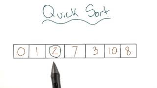

# Divide and Conquer: Merge Sort and Quick Sort

---

# Overview

- Apply divide and conquer
- Connect balanced recursive splits to O(n log n) work
- Compare merging with pivot-based partitioning

---

# Divide and Conquer

- **Divide:** split a problem into smaller subproblems
- **Conquer:** solve each subproblem recursively, stopping at a simple base case
- **Combine:** use the smaller results to finish the original problem
- Merge sort divides by position; quicksort divides by value using a pivot

---

# Where Does log n Come From?

- With balanced splits, each subproblem is about half as large as its parent
- Follow one branch: 16 → 8 → 4 → 2 → 1
- Halving 16 takes 4 steps: log₂ 16 = 4
- In general, balanced halving creates about log₂ n levels of splitting

---

# Why n log n Work?

- Count the work across **all subproblems at one level**, not just one branch
- Merge sort processes about n items per level: n, then 2 × n/2, then 4 × n/4
- O(n) work per level × O(log n) levels gives O(n log n) total work
- This pattern applies when the splits stay balanced and the total work per level is linear

---

# Divide and Conquer Is Not Automatically n log n

- Merge sort splits into near-equal halves, so its depth stays logarithmic
- Quicksort has the same pattern when its partitions are reasonably balanced
- Repeated 1-versus-(n−1) quicksort splits can require n + (n−1) + ... + 1 work: O(n²)
- Ask both questions: **How many levels? How much work per level?**

---

# Merge Sort

- Divide and Conquer
- Split until each piece has one item, then merge sorted pieces
- During a merge, repeatedly take the smaller front item

---

# Merge Sort Code

```java
void mergeSort(int arr[], int l, int r) {
    if (l < r) {
        int m = l + (r - l) / 2;
        mergeSort(arr, l, m);
        mergeSort(arr, m + 1, r);
        merge(arr, l, m, r);
    }
}
```

---

# Merge Sort: One Merge Step

- Start with two already-sorted halves: [2, 7] and [3, 5]
- Compare the front values and take the smaller: 2, then 3, then 5
- When one half is empty, copy the remainder: 7
- The result [2, 3, 5, 7] is sorted; each item is copied once during this merge

---

# Merge Sort: Big Ideas

- **Choose it for a time guarantee:** standard merge sort takes O(n log n), even on unfavorable input
- **Budget for storage:** the usual array implementation needs O(n) extra space
- **Preserve equal-key order:** take from the left half first when keys tie
- **Compare the work:** merging copies values in order instead of repeatedly swapping neighbors

---

# From Merge Sort to Quick Sort

- Merge sort splits by position, then does the main ordering work while merging
- Quicksort partitions by value before recursively sorting the resulting groups
- The key comparison: predictable splits and extra storage versus in-place partitioning and pivot-dependent balance

---

# Quick Sort

- Uses pivot element
- Partitioning separates smaller and larger values around the pivot
- Recursively sort the two sides

---

# Quick Sort Code

```java
int partition(int arr[], int low, int high) {
    int pivot = arr[high];
    int i = low - 1;
    for (int j = low; j < high; j++) {
        if (arr[j] < pivot) {
            i++;
            int temp = arr[i];
            arr[i] = arr[j];
            arr[j] = temp;
        }
    }
    int temp = arr[i + 1];
    arr[i + 1] = arr[high];
    arr[high] = temp;
    return i + 1;
}
```

---

# Quick Sort: After Partitioning

- The shown partition function puts the pivot at its final sorted index
- Recursively sort the values to its left and right, excluding the pivot
- Stop when a subarray has zero or one item; no merge step is needed

---

# Quick Sort Video



[Watch: Quick Sort](https://www.youtube.com/watch?v=kUon6854joI)

[Optional fun video: Quick Sort — Hungarian Dance](https://www.youtube.com/watch?v=3San3uKKHgg)

---

# Quick Sort: Pivot Choices

- Efficient when pivot choice is good
- Strategies:
  - First item
  - Last item
  - Random pivot
  - Median of three

---

# Quick Sort: Big Ideas

- **Balanced partitions:** usually give O(n log n) work
- **Unbalanced partitions:** can lead to O(n²), such as sorted input with the shown last-item pivot
- **Memory tradeoff:** partitioning is in place, but recursive calls still use stack space
- **Equal keys:** the usual in-place version is not stable; pivot strategy and duplicate handling matter

---

# Merge Sort vs Quick Sort Video

[Watch: Merge Sort vs Quick Sort](https://www.youtube.com/watch?v=es2T6KY45cA)

---

# Choosing Between Merge Sort and Quick Sort

| Priority | Consider | Watch for |
|---|---|---|
| Predictable time and stable output | Merge sort | Extra array storage |
| Good typical speed with in-place partitioning | Quick sort | Bad partitions, recursion depth, instability |

Choose based on the input and requirements, not the algorithm's name alone.

---

# Summary

- Balanced splitting with linear work per level leads to O(n log n)
- Merge sort recursively divides and merges data
- Quicksort partitions values around a pivot
- Pivot choices and extra storage affect performance

---

# Next: Use More Than Comparisons

- So far, ordering comes from comparing one value with another
- What if the keys have a small range, useful groups, or a fixed number of digits?
- Next, compare algorithms that exploit those properties and ask what work and storage replace comparisons
