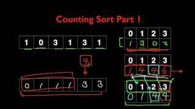

# Non-Comparison and Hybrid Sorting

---

# Overview

- Explore counting, bucket, and radix sorts
- Identify restrictions on supported data
- Consider hybrid algorithms and library sorting

---

# Non-comparison Sorting

Examples:
- Counting Sort
- Radix Sort
- Bucket Sort

Only works for restricted data.

---

# Read the Cost Model Carefully

- **n:** number of items being sorted
- **Counting sort:** O(n + r), where r is the size of the supported value range
- **Radix sort:** O(d(n + b)) with counting-based passes; d is the number of digits and b the digit base
- A linear-looking runtime is useful only when its other parameters stay manageable

---

# Counting Sort

- Uses count array
- Count how often each value occurs instead of comparing pairs
- Read the counts in key order to build the sorted output

---

# Counting Sort: Iterations Update Counts

Input: [3, 1, 2, 1]. Columns are **keys**, and cells are counts rather than array positions.

| Input iteration | Count of 1 | Count of 2 | Count of 3 |
|---|---|---|---|
| Start | 0 | 0 | 0 |
| Read 3 | 0 | 0 | 1 |
| Read 1 | 1 | 0 | 1 |
| Read 2 | 1 | 1 | 1 |
| Read 1 | 2 | 1 | 1 |

- After counting, scan the keys in order: two 1s, one 2, one 3 → [1, 1, 2, 3]
- Work includes the input scan **and** the key-range scan; counts are not sorted runs

---

# Counting Sort Video

[Watch: Counting Sort](https://www.youtube.com/watch?v=OKd534EWcdk)

---

# Counting Sort: Big Ideas

- **Work:** count the items and process the supported value range
- **Memory:** a count for every possible key can be wasteful when the range is large
- **Requirements:** keys must map to discrete indices; arbitrary decimals do not work directly
- **Stability:** sorting records stably requires placing equal-key records in their original order

---

# From Counting Values to Grouping Ranges

- Counting sort gives each possible value its own count
- What if several nearby values share a bucket instead?
- Bucket sort saves the exact ordering work for smaller groups, so their sizes matter

---

# Bucket Sort

- Scatter values into ordered ranges, such as scores 0–9, 10–19, and so on
- Sort the values within each bucket
- Gather the buckets in range order

---

# Bucket Sort: Groups Across, Stages Down

Input: [23, 8, 17, 4, 21, 12]. Each column holds a value range.

| Stage | Bucket 0–9 | Bucket 10–19 | Bucket 20–29 |
|---|---|---|---|
| Before distribution | [] | [] | [] |
| After distributing all 6 items | [8 4] | [17 12] | [23 21] |
| After sorting within each bucket | [4 8] | [12 17] | [21 23] |

- Gather left to right: [4, 8, 12, 17, 21, 23]
- Each stage contains iterations; the bucket-sorting row hides each inner sort's work
- If all values land in one bucket, the inner sorting job is still large

---

# Bucket Sort Video

---

# Bucket Sort: Big Ideas

- **Work:** distribute items, sort each bucket, then gather buckets in range order
- **Input:** evenly distributed values keep buckets small; crowded buckets lose that advantage
- **Memory:** buckets and their contents require additional storage
- **Tradeoff:** performance depends on bucket choices and the inner sort; it can degrade to O(n²)

---

# From Buckets to Digit Passes

- Bucket sort groups by value range, then sorts within each group
- Radix sort instead groups repeatedly using one digit at a time
- For least-significant-digit radix sort, each pass must preserve the order established by earlier passes

---

# Radix Sort

- Processes digits individually
- For least-significant-digit radix sort, work from the ones digit leftward
- Each pass must preserve earlier digit ordering among equal current digits

---

# Radix Sort: One Digit Pass per Row

Read array positions across each row. Treat missing leading digits as zero.

| After pass | 0 | 1 | 2 | 3 | 4 | 5 | 6 | 7 |
|---|---|---|---|---|---|---|---|---|
| Start | 170 | 45 | 75 | 90 | 802 | 24 | 2 | 66 |
| Ones | 170 | 90 | 802 | 2 | 24 | 45 | 75 | 66 |
| Tens | 802 | 2 | 24 | 45 | 66 | 170 | 75 | 90 |
| Hundreds | 2 | 24 | 45 | 66 | 75 | 90 | 170 | 802 |

- After the tens pass, values are ordered by their last two digits, not their whole values
- Stable digit passes preserve earlier ordering; each row still processes all eight items
- More digits mean more rows; a short table helps only if each pass is affordable

---

# Radix Sort Video

[Watch: Radix Sort](https://www.youtube.com/watch?v=Uey0-GOMtT8)

[Watch: Radix Sort — Additional Video](https://www.youtube.com/watch?v=mVRHvZF8xtg)

---

# Radix Sort: Big Ideas

- **Work:** every digit adds another pass over the items
- **Input:** short, consistently represented keys keep the number of passes small
- **Stability:** each least-significant-digit pass must keep equal current digits in order
- **Tradeoff:** fewer comparisons, but repeated passes and extra storage still have a cost

---

# Non-Comparison Sorts: What Replaces Comparisons?

| Algorithm | What drives the work? | What can go wrong? |
|---|---|---|
| Counting | Number of items and size of the value range | A huge range wastes time and memory |
| Bucket | Distribution of items among buckets | Crowded buckets leave large sorting jobs |
| Radix | Number of digit passes and work per pass | Long keys require more passes |

Avoiding comparisons does not mean avoiding work or extra storage.

---

# When Is a Specialized Sort Worth It?

- **Check the keys first:** can values be mapped to counts, ranges, or digits?
- **Check the input's shape:** a small range or short keys can make specialization useful
- **Count all the costs:** allocating buckets, initializing counts, moving records, and repeated passes
- **Check correctness requirements:** stability may require extra storage or a stable inner sort

---

# Comparing the Two Families

| Feature | Comparison Sorting | Non-Comparison Sorting |
|---|---|---|
| Main cost driver | Comparisons and data movement | Key range, digits, or bucket distribution |
| Typical goal | O(n log n) for efficient general sorts | Near-linear time when assumptions hold |
| Examples | Quick, Merge | Counting, Radix |
| Best Use Cases | General data | Integers and fixed ranges |

---

# From Choosing One Sort to Combining Sorts

- Different inputs expose different strengths: small pieces, existing order, or predictable splits
- One algorithm does not have to handle every stage of the job
- A hybrid chooses strategies for parts of the problem while preserving the required guarantees

---

# Hybrid Sort

- Combines multiple sorting algorithms
- Use different strategies for different input sizes or patterns
- Often switches to insertion sort for small pieces to reduce overhead

---

# Arrays.sort in Java

- Primitives: Quicksort
- Objects: TimSort
- TimSort combines Merge Sort and Insertion Sort
- TimSort finds already-sorted runs rather than always starting from single items
- It extends short runs with insertion sort, then merges the runs

---

# Hybrid Sorting: Small Runs, Then Merges

One possible hybrid uses insertion sort for small blocks, then merges the resulting runs.

| Stage | Groups or sorted runs across the row |
|---|---|
| Small unsorted blocks | [7 1 4] [8 3 2] [6 0 5] |
| After insertion-sorting each block | [1 4 7] [2 3 8] [0 5 6] |
| After merging the first two runs | [1 2 3 4 7 8] [0 5 6] |
| After the final merge | [0 1 2 3 4 5 6 7 8] |

- These rows are phases, not individual comparisons; each phase contains its own iterations
- A run is internally sorted, but its values can move when merged with another run

---

# Hybrid Sorting: Big Ideas

- **Different scales favor different strategies:** insertion sort can handle small pieces with little overhead
- **Existing order is useful:** recognizing sorted runs can avoid rebuilding work already done
- **Requirements still matter:** combining algorithms must preserve any promised stability or memory limits
- **Measure the whole job:** a better growth rate does not guarantee a faster result for every input size

---

# Summary

- Non-comparison sorts exploit properties of keys
- Counting sort depends on the value range
- Bucket sort groups values before sorting within buckets
- Radix sort processes keys one digit at a time
- Hybrid sorts combine strategies to balance tradeoffs

---

# Many More Sorts, the Same Big Questions

- **We studied only a sample:** many other algorithms and variations target different needs
- **What work grows?** Count comparisons, swaps, shifts, copies, and passes as input grows
- **What does the input offer?** Consider size, existing order, duplicate keys, range, and distribution
- **What must we preserve?** Balance runtime, extra memory, stability, and worst-case guarantees

The goal is to explain why a sorting strategy fits a problem, not just memorize its steps.
