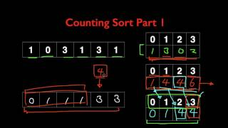

# Non-Comparison and Hybrid Sorting

---

# Overview

- Explore counting, bucket, and radix sorts
- Identify restrictions on supported data
- Consider hybrid algorithms and library sorting

---

# Non-comparison Sorting

Examples:
- Counting Sort
- Radix Sort
- Bucket Sort

Only works for restricted data.

---

# Appreciating what it means…

- O(n)
- O(nk)
- O(n+k)

k = number of keys

---

# Counting Sort

- Uses count array
- Works for small integer ranges

---

# Counting Sort Video

---

# Thoughts on Counting Sort

- Requires extra space
- Depends on value range
- Does not work on decimal values

---

# Common Theme of Non-Comparison Sorts

- Not general-purpose sorting
- Solve only specific problems

---

# Bucket Sort

- Scatter
- Sort buckets
- Gather

---

# Bucket Sort Video

---

# Thoughts on Bucket Sort

- Uniform distribution matters
- K = number of buckets
- Can degrade toward O(n²)

---

# Radix Sort

- Extension of bucket sort
- Processes digits individually
- Stable sorting approach

---

# Radix Sort Video

---

# Thoughts on Radix Sort

- O(nk)
- k = number of digits
- Efficient when k is small

---

# Summary

| Feature | Comparison Sorting | Non-Comparison Sorting |
|---|---|---|
| Time Complexity | O(n log n) | O(n) special cases |
| Uses Comparisons? | Yes | No |
| Examples | Quick, Merge | Counting, Radix |
| Best Use Cases | General data | Integers and fixed ranges |

---

# Hybrid Sort

- Combines multiple sorting algorithms

---

# Arrays.sort in Java

- Primitives: Quicksort
- Objects: TimSort
- TimSort combines Merge Sort and Insertion Sort

---

# Overall takeaways…

- Many sorting algorithms exist
- Runtime and space tradeoffs matter
- Some are general-purpose
- Some only solve specialized sorting problems

---

# Summary

- Non-comparison sorts exploit properties of keys
- Counting sort depends on the value range
- Bucket sort groups values before sorting within buckets
- Radix sort processes keys one digit at a time
- Hybrid sorts combine strategies to balance tradeoffs
