# Tree Fundamentals and Representations

---

# Overview

- Define roots, nodes, edges, and leaves
- Describe hierarchy and recursive subtrees
- Explore general tree representations

---

# A Tree Example

<!-- image size="600px" -->
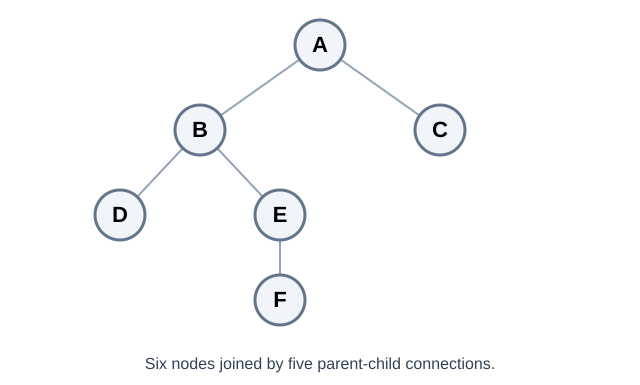

We will reuse these six labeled nodes to describe relationships, paths, depth, and height. The labels do not imply a sorting rule.

---

# Data Structure Tree vs. Natural Tree

- We usually draw the root at the top and its descendants below it
- A connection downward represents a parent-child relationship
- The root has no parent; the drawing's orientation is only a convention
- Folder structures and organizational charts are familiar examples of hierarchies

---

# Nodes: The Items in the Tree

<!-- column -->

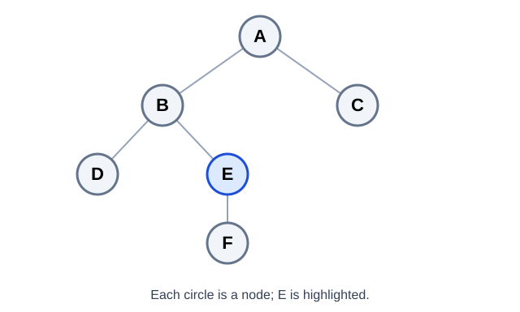

<!-- column -->

- A **node**, also called a **vertex**, represents one item in the structure
- It can store a key or payload, such as a number, folder name, or record
- It also participates in relationships with other nodes
- Our example has six nodes: A, B, C, D, E, and F

Two different nodes can store equal values; node identity and stored value are different ideas.

<!-- endcolumns -->

---

# Edges: The Connections Between Nodes

<!-- column -->

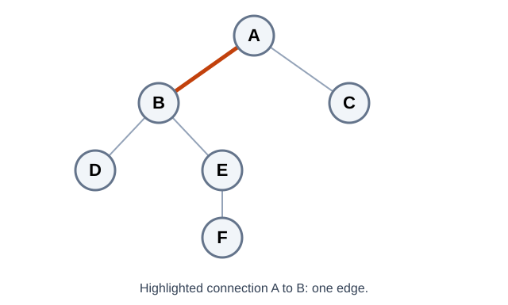

<!-- column -->

- An **edge** connects a parent to one of its immediate children
- A → B is one edge; A → B → E uses two edges
- In linked storage, an edge can be represented by a child reference
- In array storage, an edge can be implied by indices rather than stored as a separate object

Our example has five edges connecting its six nodes.

<!-- endcolumns -->

---

# Root: Where the Hierarchy Starts

<!-- column -->

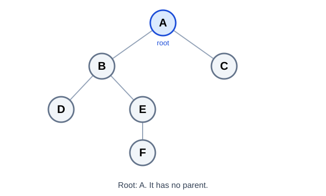

<!-- column -->

- The **root** is the one node with no parent: A in our example
- Every other node can be reached by following child links from the root
- A nonempty rooted tree has exactly one root; an empty tree has none
- A one-node tree's only node is both its root and a leaf

Root describes a structural role, not the smallest or largest key. Updates can change which node is the root.

<!-- endcolumns -->

---

# Parents, Children, and Siblings

<!-- column -->

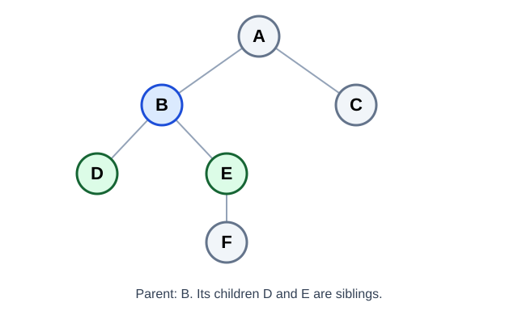

<!-- column -->

| Relationship | Meaning | Example |
|---|---|---|
| Parent | Node immediately above another | B is E's parent |
| Child | Node immediately below another | E is B's child |
| Siblings | Different nodes with the same parent | D and E are siblings |

- A node can have multiple children, but only one parent in a rooted tree
- F is B's descendant, but not B's immediate child

<!-- endcolumns -->

---

# Ancestors and Descendants

<!-- column -->

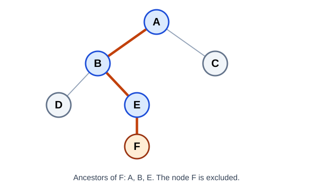

<!-- column -->

- **Ancestors:** the parent, grandparent, and other nodes toward the root
- **Descendants:** children, grandchildren, and other nodes below a node
- F's ancestors are E, B, and A; B's descendants are D, E, and F
- C and F are not ancestors or descendants of each other

Here, ancestors and descendants exclude the node itself. A subtree rooted at a node includes that node.

<!-- endcolumns -->

---

# Tree defined

- A rooted tree has one root and no cycles
- Every other node has exactly one parent
- Every node is reachable from the root by one unique path
- A nonempty tree with n nodes has n − 1 edges

---

# Leaves and Internal Nodes

<!-- column -->

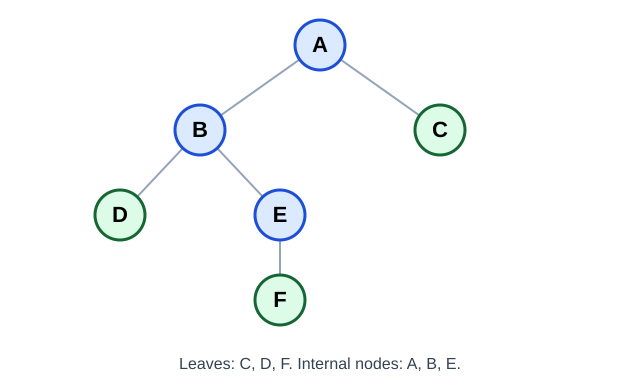

<!-- column -->

- A **leaf** has no children: C, D, and F in our example
- An **internal node** has at least one child: A, B, and E
- The root can be an internal node or, in a one-node tree, a leaf
- Adding or removing children can change whether a node is a leaf

A node with only one child is still an internal node.

<!-- endcolumns -->

---

# Degree: How Many Children?

<!-- column -->

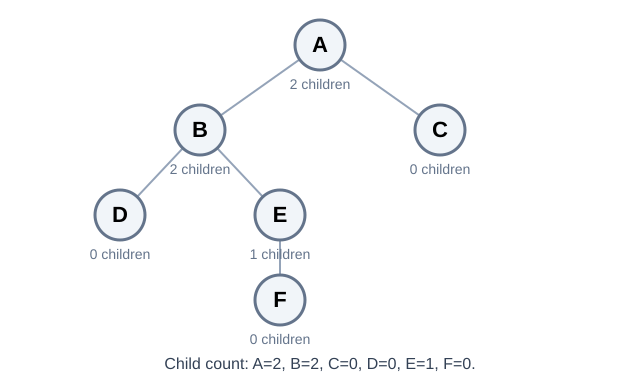

<!-- column -->

- In this rooted-tree context, a node's **degree** is its number of children
- B has degree 2; E has degree 1; every leaf has degree 0
- The tree's degree is the largest child count of any node: 2 in our example
- A general tree can have more than two children per node; later, binary trees will restrict that number to two

In graph terminology, degree instead counts incident edges, including the parent edge. Check the context.

<!-- endcolumns -->

---

# Recursive Definition

<!-- column -->

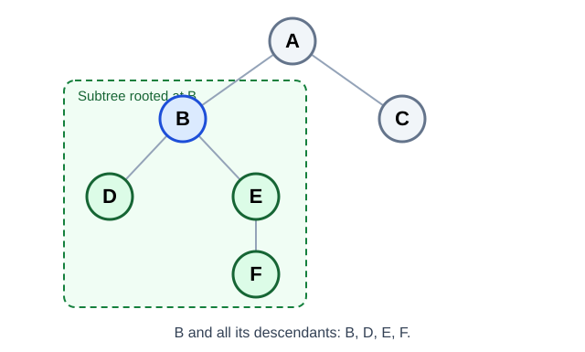

<!-- column -->

- A tree consists of a root and zero or more child subtrees
- Each child subtree is itself a tree, with that child as its root
- B's subtree contains B, D, E, and F, with the connections among them
- A subtree includes all descendants of its root, not just one selected path

This lets us solve a tree problem by applying the same operation to smaller trees.

<!-- endcolumns -->

---

# Paths and Path Length

<!-- column -->

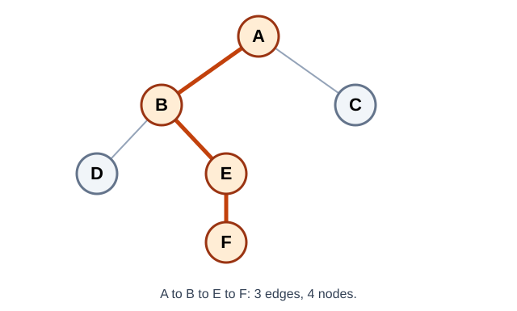

<!-- column -->

- A **path** is a sequence of nodes connected by edges
- A → B → E → F is a downward path from the root to F
- Its length is 3 edges, even though it contains 4 nodes
- There is exactly one root-to-node path for each node in a rooted tree

Counting edges instead of nodes keeps depth and height consistent.

<!-- endcolumns -->

---

# Depth and Levels: Measure from the Root

<!-- column -->

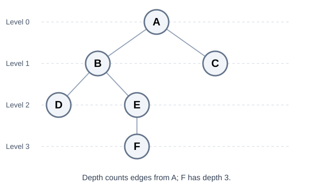

<!-- column -->

- A node's **depth** is the number of edges from the root to that node
- The root A has depth 0; B and C have depth 1
- D and E have depth 2; F has depth 3
- Nodes at the same depth form a **level**; we label levels starting at 0

Some resources number the root as level 1. We will use level = depth throughout these lectures.

<!-- endcolumns -->

---

# Height: Measure Down to the Farthest Leaf

<!-- column -->

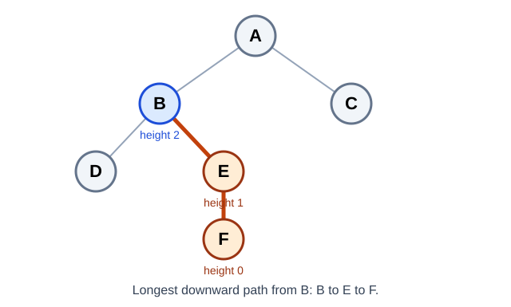

<!-- column -->

- A node's **height** is the longest downward path from it to a leaf, in edges
- Leaves C, D, and F have height 0; E has height 1
- B has height 2; A has height 3
- The tree's height is the height of its root, also the maximum node depth

Count edges, not nodes: B → E → F contains three nodes but gives B a height of two.

<!-- endcolumns -->

---

# Depth vs Height in the Same Tree

<!-- column -->


<!-- column -->

| Node | Depth: root to node | Height: node to farthest leaf |
|---|---|---|
| A | 0 | 3 |
| B | 1 | 2 |
| C | 1 | 0 |
| D | 2 | 0 |
| E | 2 | 1 |
| F | 3 | 0 |

Depth measures a node's position in the whole tree; height measures the size of its longest downward path.

<!-- endcolumns -->

---

# Size, Height, and Width Are Different

<!-- column -->


<!-- column -->

- **Size:** number of nodes; our example's size is 6
- **Height:** longest root-to-leaf path; our example's height is 3 edges
- **Width:** maximum number of nodes at any one level; our example's width is 2
- A long chain can have large height but width 1

The same number of nodes can form trees with very different shapes and path lengths.

<!-- endcolumns -->

---

# Why trees?

- Need to organize hierarchical data
- Organize things in such a way that the longest path to a specific item is short (from the root)
- In other words, keep nodes as close to the root as possible
- In other words, the longest path in a tree is the height of the tree

---

# Implementation…

<!-- column -->

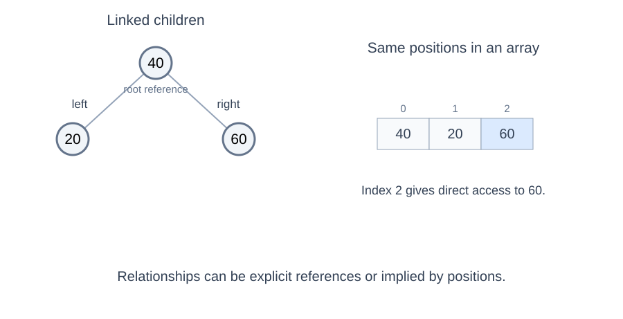

<!-- column -->

- A tree is a logical parent-child structure, not one required storage layout
- **Linked nodes:** references explicitly identify children
- **Arrays:** indices or formulas identify relationships
- Choose storage based on tree shape and the operations you need

<!-- endcolumns -->

---

# Arrays Can Store Relationships

<!-- column -->


<!-- column -->

| Index | Node | Child indices |
|---|---|---|
| 0 | A | 1, 2 |
| 1 | B | 3, 4 |
| 2 | C | None |
| 3 | D | None |
| 4 | E | 5 |
| 5 | F | None |

- Store each node's data and the indices identifying its children
- This is one general representation; later tree types allow other layouts

<!-- endcolumns -->

---

# Implementation of general tree...

```java
class Tree {
  Node root;
  class Node {
    int value;
    java.util.ArrayList<Node> children =
        new java.util.ArrayList<>();
  }
}
```

---

# General trees are … too general

- A general tree allows any number of children
- Its structure alone does not say where a new value belongs
- A file-system tree adds by folder; an ordered search tree adds by key
- Specialized trees define rules that make particular operations predictable

---

# Linked Nodes vs Arrays

| Consideration | Linked nodes | Array storage |
|---|---|---|
| Relationships | Child references | Positions or stored child indices |
| Known location | Follow references to reach it | O(1) access to a known index |
| Structural changes | Relink nodes | May move values or update indices |
| Overhead | Node objects and references | Capacity and possible unused slots |

An array of Java object references is contiguous reference storage; the objects themselves need not be contiguous.

---

# Random Access Is Not the Same as Search

| Index | 0 | 1 | 2 | 3 |
|---|---|---|---|---|
| Value | 12 | 7 | 42 | 19 |

- **Known location:** `array[2]` retrieves 42 directly in O(1)
- **Unknown location:** searching for 42 means first finding which index holds it
- Without an ordering rule, searching an array or tree may require checking every item: O(n)
- Knowing how to reach a location is different from knowing where the desired value is

---

# Where We Go Next

- **Next: binary trees and BSTs** — restrict branching and organize keys for search
- **Then: AVL trees** — maintain short search paths as data changes
- **Finally: heaps** — organize data for priority-based access

These are previews, not prerequisites. For now, focus on tree vocabulary, relationships, and storage choices; each later lecture introduces its own rules.

---

# Summary

- Trees represent hierarchies: nodes hold items and edges connect parents to children
- Every non-root node has one parent; a subtree is itself a tree
- Depth counts edges from the root; height counts the longest downward path
- Arrays and linked nodes can represent the same relationships
- Later lectures add constraints to support specific operations.