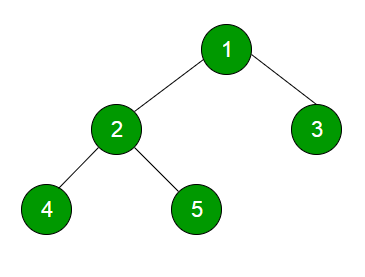

# Tree Fundamentals and Representations

---

# Overview

- Define roots, nodes, edges, and leaves
- Describe hierarchy and recursive subtrees
- Explore general tree representations

---

# A Tree Example



---

# Data Structure Tree vs. Natural Tree

Opposite of a "nature" tree - root is at the top, no "parent"

---

# Hierarchy

Parent/ancestor

Child/descendant

---

# Tree defined

- Every node can have only one parent (except root)

---

# Parts of a tree

- Nodes or vertices
- Edges

---

# Tree Terminology

Root

Leaf

Levels/Depth/Height

---

# Recursive Definition

Recursive definition - every subtree is in itself a tree

---

# More definitions

In a tree data structure, a path refers to a sequence of nodes that connects one node to another within the tree. A path is typically represented as a list of nodes, starting from one node (often the root or a parent node) and leading to a target node (usually a descendant).

<!-- footer -->
https://chatgpt.com

---

# Why trees?

- Need to organize hierarchical data
- Organize things in such a way that the longest path to a specific item is short (from the root)
- In other words, keep nodes as close to the root as possible
- In other words, the longest path in a tree is the height of the tree

---

# Implementation…

Arrays?

Linked Nodes?

---

# Arrays?

Organizing non-linear information in a linear data structure…

Possible - we’ll explore some options later

---

# Implementation of general tree...

```java
class Tree {
  Node root;
  class Node {
    ArrayList<Node> children;
  }
}
```

---

# General trees are … too general

Operations on a general tree would be fairly generic… how do we add a node?
We have to specify EXACTLY where a node needs to go.

```java
int level1child = 2;
int level2child = 3;
int level3child = 1;
root.get(level1child).get(level2child).get(level3child).add(someData);
```

---

# Variety of specialty trees

- We start with a simple one Binary Search Tree
- Many, many others
- Heaps (min and max heaps)
- AVL
- Red-Black
- etc.
- Each of these trees have more constraints, so they’re organized with more strict rules. Therefore, the operations are also simpler.

---

# Summary

- Trees represent parent-child hierarchies
- Each non-root node has one parent
- A subtree is itself a tree
- Arrays and linked nodes can represent tree structures
- Specialized trees add constraints to support particular operations
