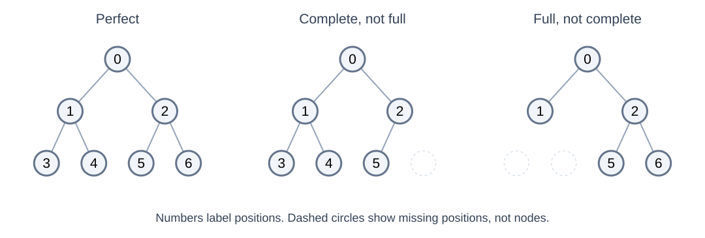
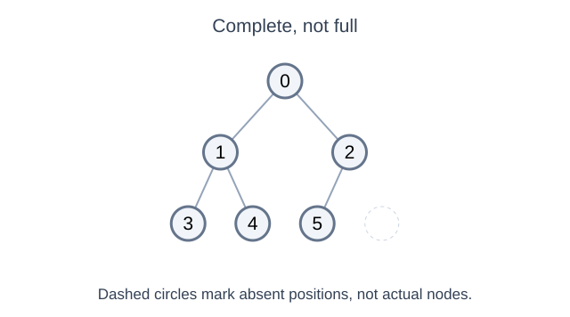
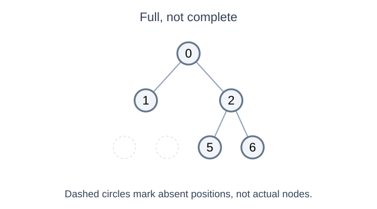
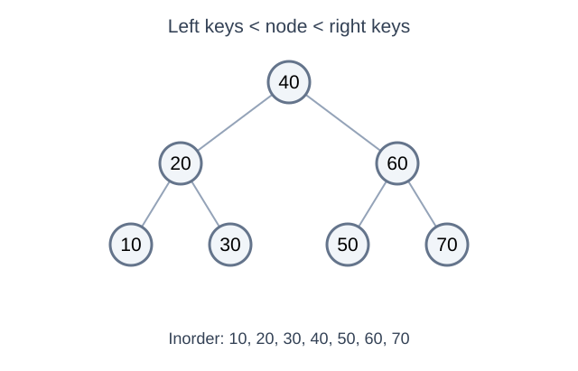
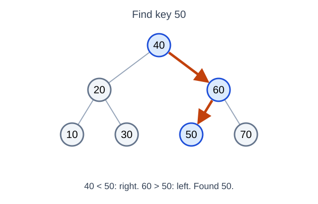
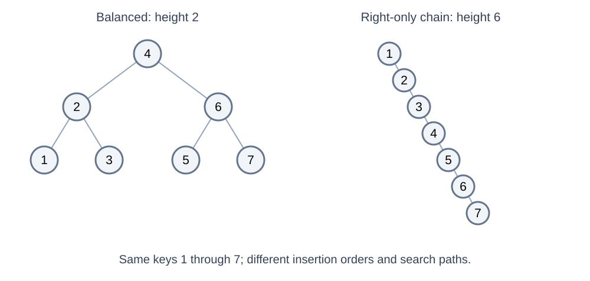
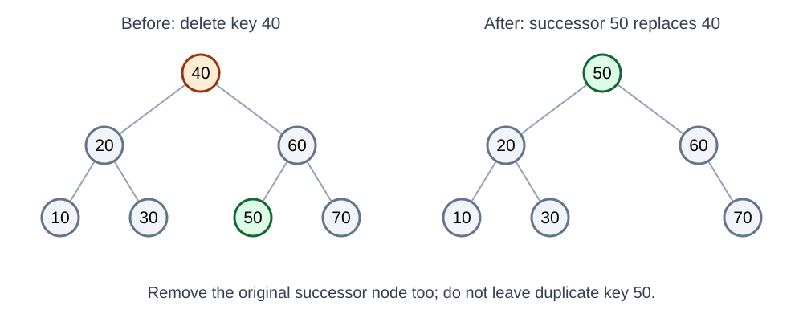

# Binary Trees and Binary Search Trees

---

# Overview

- Distinguish binary trees from search trees
- Relate search cost to tree height
- Apply the binary search tree ordering rules

---

# Binary Trees

- Each node has at most two children, distinguished as left and right
- A node may have zero, one, or two children
- Binary describes branching; it does not specify ordering or balance

---

# Full, Complete, and Perfect Are Different



| Shape term | Requirement |
|---|---|
| Full / proper | Every node has either 0 or 2 children |
| Complete | Every level except possibly the last is filled; the last fills left to right |
| Perfect | Every internal node has 2 children and all leaves have the same depth |

A perfect tree is both full and complete. A full tree need not be complete, and a complete tree need not be full.

---

# Complete but Not Full



- Six occupied positions fill levels from left to right
- Node 60 has one child: complete, but not full or perfect

---

# Full but Not Complete



- Every node has zero or two children: full
- The last level has a gap on the left: not complete

---

# Balanced Describes Height

- Balance concerns how tall subtrees become, not just how many children a node has
- A complete binary tree has logarithmic height
- An AVL tree enforces a local height-balance rule at every node
- A balanced tree need not be complete, full, or perfect
---

# Shape Does Not Determine Key Order

- The same complete shape could hold a BST, a heap, or neither
- BST ordering compares each key with all keys in its left and right subtrees
- Heap ordering compares each parent with its children
- Inspect both the shape and the values before naming the structure

---

# Recursive definition

- Every subtree of a binary tree is a binary tree

---

# Why do these things exist?

- A short tree can provide a short root-to-leaf path
- Search is O(height) only when a rule tells us which branch to choose
- Height O(log n) allows logarithmic search in a BST
- A binary tree without an ordering rule may require examining every node

---

# Tree Traversal

<!-- column -->



<!-- column -->

- A path down one branch has length at most the tree's height
- A traversal that visits every node takes O(n), even in a balanced tree
- Preorder visits node, left, right; inorder visits left, node, right
- Postorder visits left, right, node; level order visits by depth

To avoid searching every branch, we need an ordering rule.

<!-- endcolumns -->

---

# Binary Search Tree (BST)

<!-- column -->


<!-- column -->

- For distinct keys: every left-subtree key is smaller than the node's key
- Every right-subtree key is larger; both subtrees obey the same rule
- This applies to whole subtrees, not only immediate children
- Choose an explicit duplicate-key policy; these examples ignore duplicate inserts

<!-- endcolumns -->

---

# Why?

Facilitates Binary Searching

Logical key ordering, not necessarily sorted physical storage

Splits up some of the work involved in retrieval of data

- Sorts as data is inserted
- Intuitive binary search retrieval

---

# Pros and cons

| Choice | Search for a key | Main update cost |
|---|---|---|
| Unsorted array | O(n) | Append is cheap when space is available |
| Sorted array | O(log n) binary search | Maintain order by shifting up to O(n) values |
| Linked BST | O(h) | Follow a path and change links; balance is not automatic |

An ordinary BST trades array indexing and compact storage for flexible linked structure; its shape still determines performance.

---

# Basics

- The left subtree of a node contains only nodes with keys lesser than the node’s key.
- The right subtree of a node contains only nodes with keys greater than the node’s key.
- The left and right subtree each must also be a binary search tree.

---

# A Typical Linked BST Node

```java
class Node {
    int key;
    Node left;
    Node right;

    Node(int key) {
        this.key = key;
    }
}
```

- Missing children are `null`; their absence does not reserve array slots
- A tree object keeps a reference to its root

---

# Searching Follows One Path

<!-- column -->



<!-- column -->

```java
boolean contains(Node node, int key) {
    while (node != null) {
        if (key == node.key) return true;
        node = key < node.key ? node.left : node.right;
    }
    return false;
}
```

- Each comparison rules out an entire subtree
- Time is O(h): O(log n) when balanced, O(n) when skewed

<!-- endcolumns -->

---

# The Same Keys Can Have Very Different Heights

<!-- column -->



<!-- column -->

| Insertion order | Resulting shape | Height for 7 nodes |
|---|---|---|
| 4, 2, 6, 1, 3, 5, 7 | Perfect BST | 2 edges |
| 1, 2, 3, 4, 5, 6, 7 | Right-only chain | 6 edges |

- Ordinary BST insertion does not guarantee balance
- Inorder traversal produces 1 through 7 in either case
- A balanced search path and a full traversal have different costs

<!-- endcolumns -->

---

# BST Updates: What Must Be Preserved?

- **Insert:** follow comparisons to a missing child position
- **Delete a leaf:** remove its parent's link
- **Delete a one-child node:** link its parent to its child
- **Delete a two-child node:** replace its key with its inorder successor, then delete that successor node

An ordinary BST preserves ordering, but these updates do not automatically restore balance.

---

# Deleting a Two-Child Node: A Picture



- The successor is the smallest key in the right subtree: 50
- Replace 40 with 50, then remove the original 50 node; other BST relationships remain valid

---

# Why Linked Nodes Are Common for BSTs

- Irregular shapes need only actual nodes, not positional holes
- Insertion changes a reference instead of shifting a sorted array
- Rotations can rearrange a few links without moving every stored value
- Costs include per-node allocation, reference overhead, and pointer chasing

An array of records with child indices is also possible; it is different from a heap's implicit positional layout.

---

# Next: Two Different Ways to Keep a Tree Short

- **AVL:** preserve BST ordering and repair height imbalance with rotations
- **Binary heap:** preserve a complete shape and only parent-child priority order
- Both have logarithmic height, but they support different searches and updates

---

# Summary

- Binary tree nodes have at most two children
- A binary tree alone does not guarantee efficient search
- BST ordering directs a search toward one subtree
- Search follows tree height: balanced trees offer shorter paths
- Insertion and retrieval involve tradeoffs in maintaining structure
