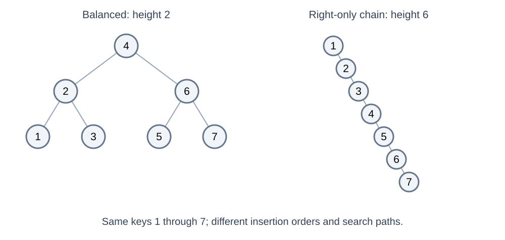
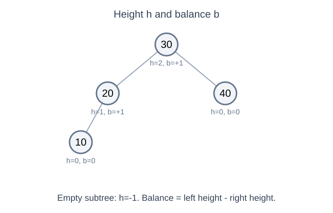
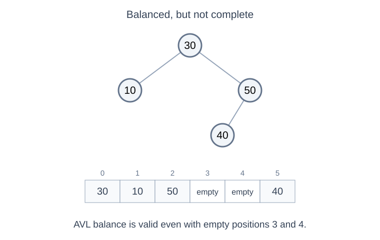
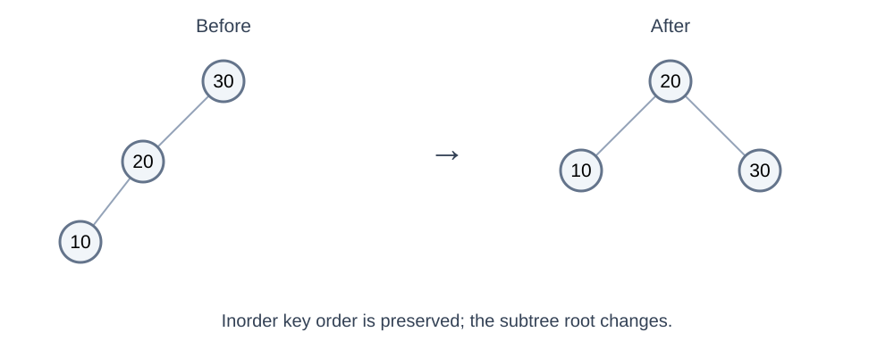
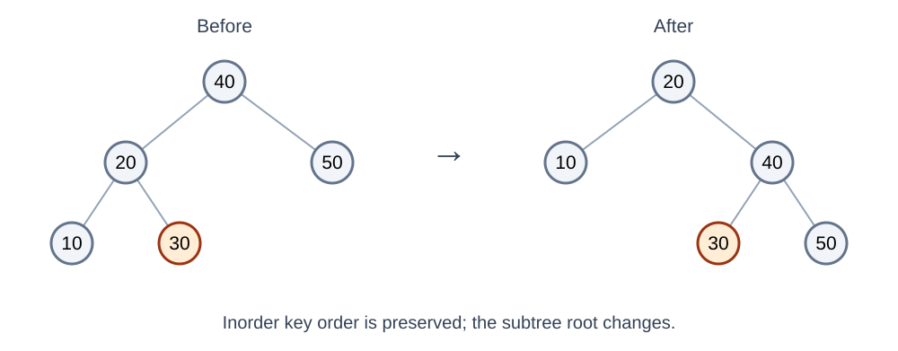
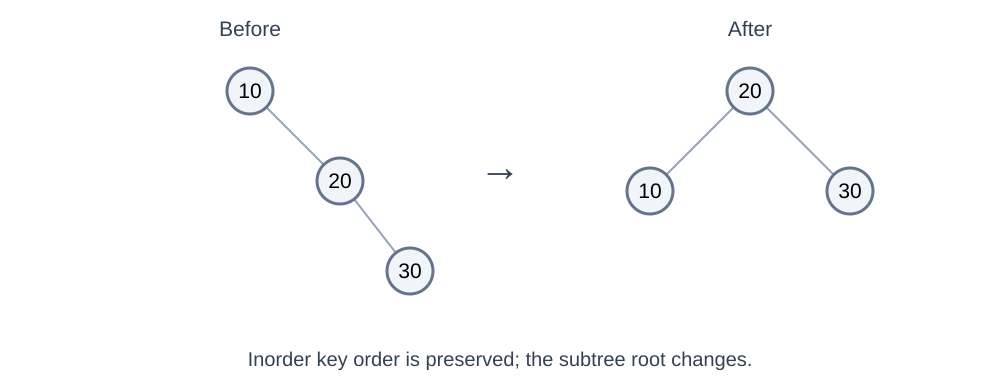
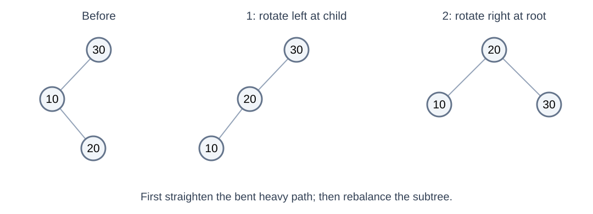
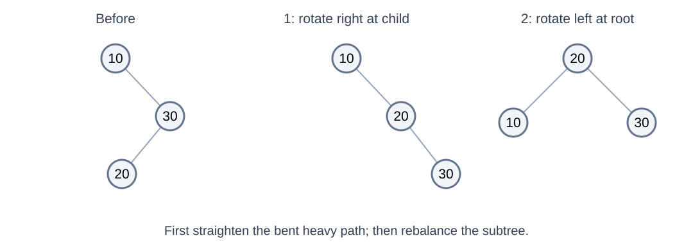
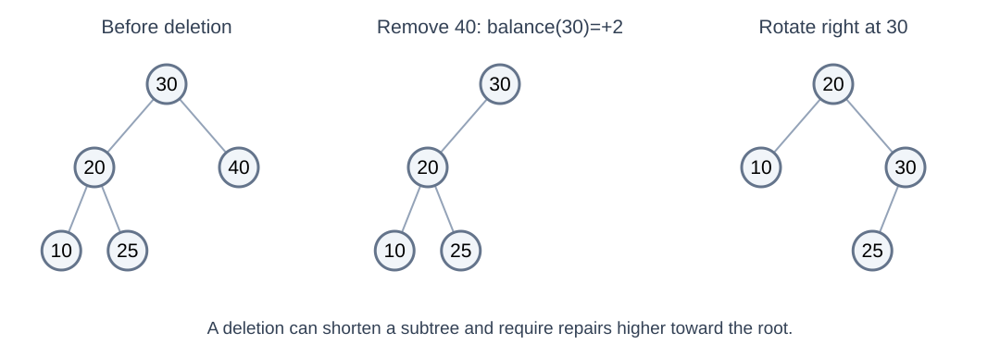

# AVL Trees: Balanced Search and Linked Nodes

---

# Overview

- Explain why BST ordering alone does not keep search fast
- Track subtree heights and balance factors
- Trace single and double rotations
- Compare linked-node storage with array alternatives

---

# From a BST to an AVL Tree

<!-- column -->



<!-- column -->

- Inserting increasing keys into an ordinary BST can create a chain
- A chain has height O(n), so search and updates can take O(n)
- An **AVL tree is a BST with an additional height-balance rule**
- After insertion or deletion, repair that rule without losing key ordering

<!-- endcolumns -->

---

# The AVL Balance Rule

- At **every node**, left and right subtree heights differ by at most one
- Define balance factor as `height(left) - height(right)`
- Valid balance factors: −1, 0, +1
- A factor of +2 or −2 after an update requires rebalancing

Convention: an empty subtree has height −1; a leaf has height 0.

---

# Height and Balance: Read Bottom Up



- At 20: left height 0 minus right height −1 gives +1
- At 30: left height 1 minus right height 0 gives +1
- Every node is balanced; the shape does not have to be perfect

---

# Balanced Does Not Mean Complete



- This is an AVL-valid BST: the subtree-height difference is at most one everywhere
- It is **not complete**: a last-level node appears after missing positions on the left
- AVL trees do not require the heap's left-to-right filling rule
- They also need not be full: node 50 has one child

---

# Typical Implementation: Linked Nodes

```java
static class Node {
    int key;
    int height = 0;
    Node left, right;

    Node(int key) {
        this.key = key;
    }
}
```

- A tree stores a `Node root` reference
- Store height, or an equivalent balance field, to avoid repeatedly traversing subtrees
- Child references make local structural changes straightforward

---

# Height Helpers

```java
static int height(Node n) {
    return n == null ? -1 : n.height;
}

static void updateHeight(Node n) {
    n.height = 1 + Math.max(height(n.left), height(n.right));
}

static int balance(Node n) {
    return n == null ? 0 : height(n.left) - height(n.right);
}
```

Stored child heights make each height update O(1).

---

# Insertion: Down for Position, Up for Repair

| Direction | Work |
|---|---|
| Down the tree | Follow BST comparisons to the insertion point |
| At a missing child | Create a leaf |
| Back toward the root | Update heights and check balance |
| At an imbalance | Rotate and return the new subtree root |

- Only ancestors of the new leaf can have changed heights
- Rotations change links, so callers must keep the returned root reference

---

# Right Rotation: Repair a Left-Left Case

Insert 30, 20, 10. The node 30 becomes too left-heavy.



- Lift 20; make 30 its right child
- Inorder remains 10, 20, 30: the BST ordering is preserved
- The subtree root changes from 30 to 20

---

# Rotations Must Preserve the Middle Subtree



- Here x is 20, y is 40, and the middle subtree contains 30
- The middle subtree moves from `x.right` to `y.left`; it must not be lost
- Rotations relink a few nodes, rather than re-sorting the whole tree

---

# Right Rotation in Java

```java
static Node rotateRight(Node y) {
    Node x = y.left;
    Node middle = x.right;
    x.right = y;
    y.left = middle;
    updateHeight(y);
    updateHeight(x);
    return x;
}
```

Update the lower node first, then the new subtree root.

---

# Left Rotation in Java

<!-- column -->



<!-- column -->

```java
static Node rotateLeft(Node x) {
    Node y = x.right;
    Node middle = y.left;
    y.left = x;
    x.right = middle;
    updateHeight(x);
    updateHeight(y);
    return y;
}
```

This is the mirror image of a right rotation; inserting 10, 20, 30 is a right-right case.

<!-- endcolumns -->

---

# Four Rotation Cases

| Heavy path from the unbalanced node | Example insertion order | Repair |
|---|---|---|
| Left-left | 30, 20, 10 | Rotate right |
| Right-right | 10, 20, 30 | Rotate left |
| Left-right | 30, 10, 20 | Rotate left at the child, then right |
| Right-left | 10, 30, 20 | Rotate right at the child, then left |

The names describe the heavy path, not the direction of the repairing rotation.

---

# Left-Right: Straighten, Then Rotate



1. Rotate left at 10 to convert the bent path into a left-left case
2. Rotate right at 30 to restore balance

Right-left uses the mirrored sequence.

---

# Right-Left: The Mirrored Repair



1. Rotate right at child 30 to straighten the heavy path
2. Rotate left at node 10; the new subtree root is 20

Inorder remains 10, 20, 30, just as in the left-right case.

---

# Rebalance a Subtree

```java
static Node rebalance(Node n) {
    updateHeight(n);
    if (balance(n) > 1) {
        if (balance(n.left) < 0)
            n.left = rotateLeft(n.left);
        return rotateRight(n);
    }
    if (balance(n) < -1) {
        if (balance(n.right) > 0)
            n.right = rotateRight(n.right);
        return rotateLeft(n);
    }
    return n;
}
```

Call this for a non-null node after updating one of its child links.

---

# Insertion in Java

```java
static Node insert(Node n, int key) {
    if (n == null) return new Node(key);
    if (key < n.key)
        n.left = insert(n.left, key);
    else if (key > n.key)
        n.right = insert(n.right, key);
    else
        return n; // This example ignores duplicate keys.
    return rebalance(n);
}
```

At the tree level: `root = insert(root, key);` Keep the new root after rotations.

---

# Deletion: The Same Invariants, More Repair

- Delete using the usual BST cases: leaf, one child, or two children
- For two children, replace the key with its successor and remove that successor node
- Update heights and rebalance while returning toward the root
- Unlike insertion's single repair location, deletion can require repairs at several ancestors

Search, insertion, and deletion remain O(log n) in an AVL tree.

---

# Deletion: Visualizing the Repair



- Before deletion, left and right subtree heights at 30 differ by one
- Removing 40 changes the difference to two; a right rotation repairs this subtree
- Continue checking ancestors because deletion may shorten the repaired subtree

---

# Why AVL Height Stays Logarithmic

- The balance rule prevents a long chain with an almost-empty opposite subtree
- A height-h AVL tree needs children with heights at least h−1 and h−2
- Minimum node counts grow quickly: 1, 2, 4, 7, 12, 20, ... for heights 0, 1, 2, 3, 4, 5, ...
- Equivalently, increasing the node count allows only logarithmic height growth

Balance is checked locally, but it gives a global bound on path length.

---

# AVL Operation Costs

| Operation | Typical linked AVL cost |
|---|---|
| Find a key | O(log n) |
| Insert or delete by key | O(log n) |
| Visit all keys in sorted order | O(n) |
| One single rotation | O(1) |
| Find kth-smallest without extra metadata | O(n) worst case |

Subtree-size metadata can support rank selection in O(log n), but ordinary AVL heights alone do not provide it.

---

# Could We Put an AVL Tree in an Array?

<!-- column -->


<!-- column -->

| Approach | Advantage | Cost |
|---|---|---|
| Linked nodes | Rotations change a few references | Objects, references, pointer chasing |
| Heap-style positional array | Child locations come from formulas | Irregular shapes leave holes; rotations can relocate subtrees |
| Array of records with child indices | Explicit links without one object per node | Manage indices, free slots, and rotations explicitly |

AVL does not require linked nodes, but its changing, non-complete shape makes explicit child links a natural fit.

<!-- endcolumns -->

---

# AVL: Big Ideas and Tradeoffs

- **Choose it for ordered access:** key lookup, updates, and sorted traversal
- **Pay for balance:** maintain metadata and implement rotations correctly
- **Keep operations distinct:** logarithmic key search is not O(1) array indexing
- **Do not confuse shape rules:** AVL-balanced does not mean complete or perfect

---

# Check Your Understanding

1. Insert 10, 30, 20: which node is unbalanced, and which two rotations repair it?
2. Can an AVL tree contain a node with only one child?
3. Does storing nodes in an array automatically make finding a key O(1)?

<div class="fragment">

**Discuss:** right-left at 10; yes, if heights remain valid; no, location and search are different questions.

</div>

---

# Summary and Next Step

- AVL preserves both BST ordering and local height balance
- Rotations keep search paths short without changing inorder key order
- Linked nodes make rotations local; arrays are possible with different tradeoffs
- Next: heaps keep a complete shape and weaken key ordering to optimize priority access

Further reading: [Cornell — Balanced Binary Trees](https://www.cs.cornell.edu/courses/cs2112/2022fa/lectures/avl/)
