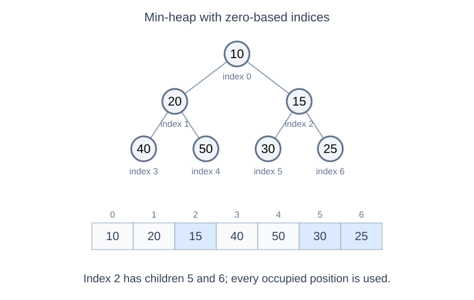
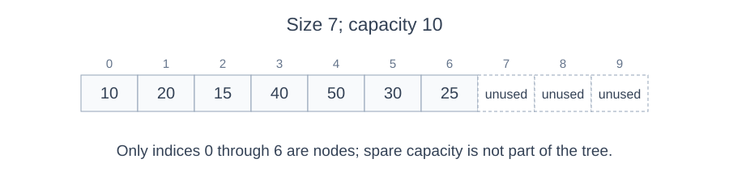
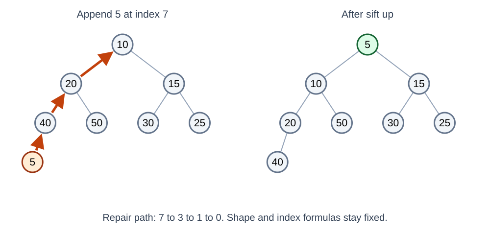
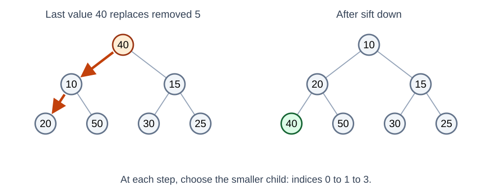
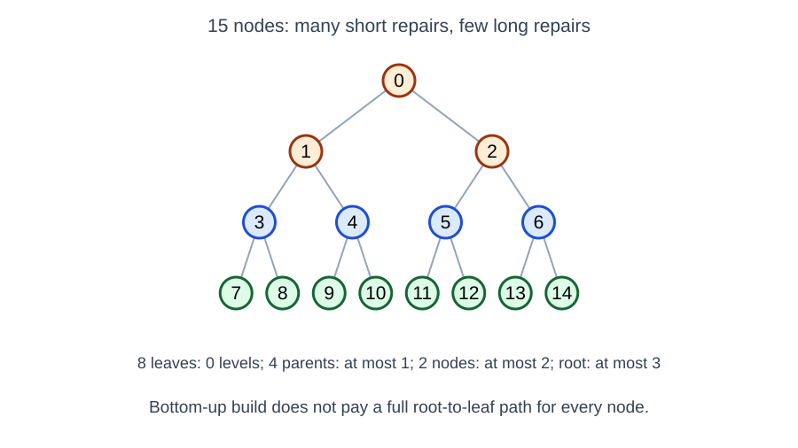
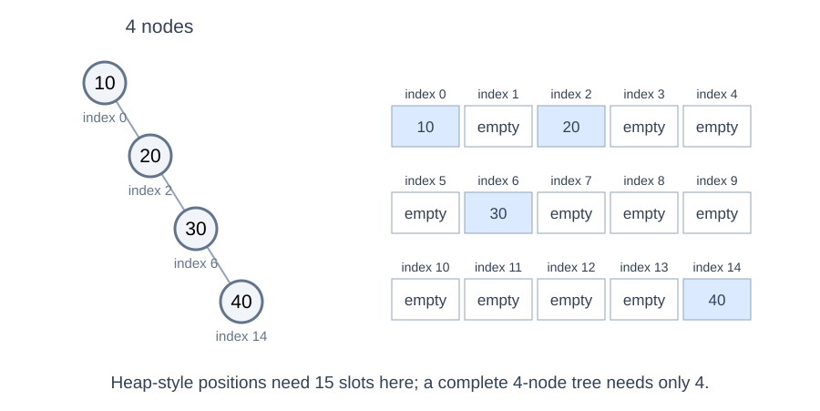
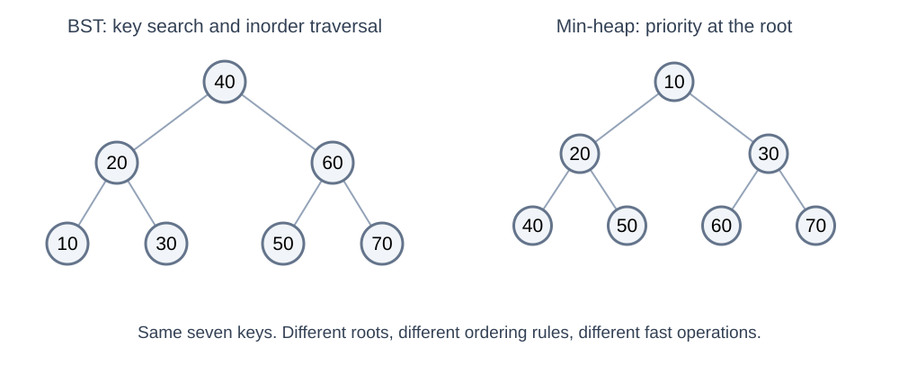

# Binary Heaps: Priority Queues and Array Storage

---

# Overview

- Separate a heap's shape rule from its ordering rule
- Map a complete binary tree to array indices
- Trace insertion, root removal, and bottom-up heap construction
- Compare heaps with linked BSTs, AVL trees, and sorted arrays

---

# From Ordered Search to Priority Access

- A BST asks: **where is a particular key?**
- A priority queue asks: **which item should be handled next?**
- A min-heap puts a minimum at the root; a max-heap puts a maximum there
- Examples: process the earliest deadline, lowest-cost event, or highest-priority job

A binary heap is a data structure used to implement the priority-queue ADT.

---

# Two Independent Heap Rules

1. **Shape:** a complete binary tree, with the last level filled left to right
2. **Order:** each parent has at least as much priority as its children

- Min-heap: parent key ≤ child keys
- Max-heap: parent key ≥ child keys

Neither rule alone defines a binary heap; both must hold.

---

# A Min-Heap Is Not a BST



- The root is no larger than any other key
- A node's descendants cannot be smaller than that node
- No required order exists between siblings or between the two subtrees
- The left child 20 is greater than the root 10: this is not BST ordering

---

# Complete, Not Necessarily Full or Perfect

- With six nodes, the first six level-order positions are occupied
- The final parent may have only a left child: complete, but not full
- With seven nodes, all three levels are filled: perfect
- Inserting an eighth node starts a new level at its far-left position

The shape rule concerns occupied positions, not whether keys are sorted.

---

# Why a Complete Shape Favors Arrays

<!-- column -->


<!-- column -->

| Index | 0 | 1 | 2 | 3 | 4 | 5 | 6 |
|---|---|---|---|---|---|---|---|
| Key | 10 | 20 | 15 | 40 | 50 | 30 | 25 |
| Role | Root | Left of 0 | Right of 0 | Left of 1 | Right of 1 | Left of 2 | Right of 2 |

- Store nodes in level order, top to bottom and left to right
- The occupied range is exactly indices 0 through size−1, with no internal holes
- No explicit child references are needed

<!-- endcolumns -->

---

# Index Arithmetic: Zero-Based Arrays

<!-- column -->


<!-- column -->

| Relationship from index i | Formula |
|---|---|
| Left child | 2i + 1 |
| Right child | 2i + 2 |
| Parent, for i > 0 | floor((i − 1) / 2) |

- A child exists only if its index is less than the logical size
- For index 2: children are 5 and 6; parent is 0
- Root index 0 has no parent; check `i > 0` before using the parent formula

<!-- endcolumns -->

---

# O(1) Indexed Access Does Not Mean O(1) Search

- `heap[5]` retrieves a known position in O(1)
- `heap[0]` retrieves the minimum of a min-heap in O(1)
- Finding an arbitrary key may require checking O(n) values
- The kth array position is not necessarily the kth-smallest key

Unlike a BST, a heap cannot choose just left or right by comparing a target with the current key.

---

# Typical Java Storage

```java
private final int[] heap;
private int size = 0;

MinHeap(int capacity) {
    heap = new int[capacity];
}

private void swap(int i, int j) {
    int temp = heap[i];
    heap[i] = heap[j];
    heap[j] = temp;
}
```

These members and the following methods belong inside a `MinHeap` class. This teaching version uses fixed capacity.

---

# Logical Size vs Array Capacity



- **Capacity:** how many entries the backing array can hold
- **Size:** how many entries currently belong to the heap
- Child bounds use `size`, not `heap.length`
- Unused capacity is not a set of tree nodes; zero can also be a valid stored key

A growable implementation can resize its array; copying during a resize is O(n).

---

# Insert: Preserve Shape, Then Restore Order



1. Append the new value at index `size` to preserve completeness
2. Compare it with its parent
3. For a min-heap, swap upward while it is smaller
4. Stop at the root or when parent-child order is valid

This is **sift up** or **bubble up**; it follows one rootward path.

---

# Insertion Trace: Add 5

| Stage | 0 | 1 | 2 | 3 | 4 | 5 | 6 | 7 |
|---|---|---|---|---|---|---|---|---|
| Append | 10 | 20 | 15 | 40 | 50 | 30 | 25 | **5** |
| Swap 7 with 3 | 10 | 20 | 15 | **5** | 50 | 30 | 25 | 40 |
| Swap 3 with 1 | 10 | **5** | 15 | 20 | 50 | 30 | 25 | 40 |
| Swap 1 with 0 | **5** | 10 | 15 | 20 | 50 | 30 | 25 | 40 |

- Only one path needs repair; the complete shape never changes during these swaps
- Swaps change which values occupy positions, not the index formulas

---

# Insertion in Java

```java
public void add(int value) {
    if (size == heap.length)
        throw new IllegalStateException("Heap is full");
    int i = size++;
    heap[i] = value;
    while (i > 0) {
        int parent = (i - 1) / 2;
        if (heap[parent] <= heap[i]) break;
        swap(parent, i);
        i = parent;
    }
}
```

With available capacity, at most O(log n) parent steps are needed.

---

# Remove the Root: Why Use the Last Item?

1. Save the root value for the caller
2. Move the last occupied value into the root position
3. Shrink the logical size by one to preserve completeness
4. Sift the replacement down until heap order is restored

Removing an arbitrary interior position without filling it would leave a gap in the complete shape.

---

# Sift Down: Choose the Better Child



- For a min-heap, choose the smaller existing child
- Swap if the parent is greater than that child
- Repeat from the child's position
- If the parent is already ≤ the smaller child, it is ≤ both children

Choosing the wrong child can leave the parent larger than its other child.

---

# Root Removal Trace: Continue After Adding 5

Start: [5, 10, 15, 20, 50, 30, 25, 40]. Return 5; replace it with the last value, 40.

| Stage | 0 | 1 | 2 | 3 | 4 | 5 | 6 |
|---|---|---|---|---|---|---|---|
| Replace root; size is 7 | **40** | 10 | 15 | 20 | 50 | 30 | 25 |
| Swap 0 with 1 | 10 | **40** | 15 | 20 | 50 | 30 | 25 |
| Swap 1 with 3 | 10 | 20 | 15 | **40** | 50 | 30 | 25 |

The moved value reaches a leaf; all parent-child comparisons are valid again.

---

# Peek and Remove in Java

```java
public int peek() {
    if (size == 0)
        throw new IllegalStateException("Heap is empty");
    return heap[0];
}

public int removeMin() {
    int result = peek();
    heap[0] = heap[--size];
    if (size > 0) siftDown(0);
    return result;
}
```

For the final item, the size becomes zero and no sifting is needed. Primitive values beyond `size` are ignored.

---

# Sift Down in Java

```java
private void siftDown(int i) {
    while (i < size / 2) { // Nodes before size/2 have children.
        int child = 2 * i + 1;
        int right = child + 1;
        if (right < size && heap[right] < heap[child])
            child = right;
        if (heap[i] <= heap[child]) break;
        swap(i, child);
        i = child;
    }
}
```

Only one downward path is followed: O(log n) worst-case repair.

---

# Build a Heap from Existing Values

- Copy the input into the occupied array range
- Every leaf already satisfies heap order by itself
- Starting with the last parent, sift down toward index 0
- Each parent's child subtrees are heaps before that parent is processed

```java
MinHeap(int[] values) {
    heap = java.util.Arrays.copyOf(values, values.length);
    size = values.length;
    for (int i = size / 2 - 1; i >= 0; i--)
        siftDown(i);
}
```

This overload uses exactly enough capacity for the input.

---

# Why Bottom-Up Build Is O(n), Not O(n log n)

<!-- column -->



<!-- column -->

| Nodes | Maximum downward work per node |
|---|---|
| About half are leaves | 0 levels |
| About a quarter are parents of leaves | 1 level |
| About an eighth are one level higher | 2 levels |
| Only a few are near the root | Up to O(log n) levels |

- Most nodes cannot travel far; summing the work gives O(n)
- Building by n repeated insertions instead has O(n log n) worst-case cost

<!-- endcolumns -->

---

# Binary Heap Operation Costs

| Operation | Array min-heap |
|---|---|
| Peek minimum | O(1) |
| Insert, with available capacity | O(log n) worst case |
| Remove minimum | O(log n) worst case |
| Bottom-up build | O(n) |
| Find an arbitrary key | O(n) worst case |
| Read a known array index | O(1), but not sorted-rank access |

A growth operation can copy O(n) entries; geometric growth gives amortized O(log n) insertion including sifting.

---

# Array Heap vs Linked-Node Heap

| Choice | Advantages | Costs |
|---|---|---|
| Array, typical for binary heaps | Dense positions; O(1) parent/child indexing; few structural fields | Capacity management; resizing may copy entries |
| Linked complete binary tree | No backing-array resize; links can identify relatives | Node/reference overhead; must locate the next leaf position and maintain shape |

Linked heaps are possible, but a linked list of nodes would lose the array's direct parent/child indexing advantage.

---

# Complete Shape Makes the Array Work

<!-- column -->



<!-- column -->

| Shape | Heap-style positional indices |
|---|---|
| Complete tree | All positions 0 through n−1 are occupied |
| Full but irregular tree | May contain large gaps despite every node having 0 or 2 children |
| Right-only chain of 4 nodes | Occupies 0, 2, 6, 14: only 4 of 15 positions used |

Full is not enough. Complete shape prevents internal holes in an implicit array layout.

<!-- endcolumns -->

---

# Heap Order Does Not Produce a Sorted Array

- Reading the min-heap array from left to right does not give sorted keys
- Inorder traversal does not give sorted keys either
- Repeatedly removing the minimum gives ascending output in O(n log n) total time
- Standard in-place heapsort uses a max-heap and an expanding sorted suffix

A priority queue also needs a tie-breaking rule if equal-priority items must be handled in insertion order.

---

# Choosing a Structure

| Need | Good starting point | Main tradeoff |
|---|---|---|
| Repeated minimum/maximum removal | Binary heap | Arbitrary search is slow |
| Ordered key lookup and updates | AVL tree | Rotations and node metadata |
| Random access by sorted rank | Sorted array | Insertion/deletion may shift O(n) values |
| Sorted traversal of changing keys | AVL tree | O(n) traversal; O(log n) updates |

All three can store ordered keys, but they maintain different relationships to make different operations fast.

---

# Heaps: Big Ideas

- **Shape supports storage:** completeness makes positional arrays compact
- **Order supports an operation:** parent-child priority puts the extreme at the root
- **Repairs stay local:** insert and root removal follow one height-bounded path
- **Random access is not search:** a known index is easy; an unknown key still needs finding

---

# Check Your Understanding

1. At index 4, where are the potential parent and children in a zero-based heap array?
2. Does an eight-node heap have to be full or perfect?
3. Why can't we search a min-heap like a BST?

<div class="fragment">

**Discuss:** parent 1, children 9 and 10 if in bounds; no; neither child subtree is selected by a BST key-ordering rule.

</div>

---

# Same Keys, Different Guarantees



- The BST supports choosing a search branch and visiting keys in order
- The min-heap puts the minimum at the root without BST ordering
- Complete shape, key ordering, and storage layout are separate choices

---

# Module Summary: Shape, Order, Storage, Operations

| Structure | Shape / balance rule | Ordering rule | Common storage |
|---|---|---|---|
| Ordinary BST | Can become skewed | Left < node < right | Linked nodes |
| AVL | Child heights differ by at most 1 | BST ordering | Linked nodes plus height/balance |
| Binary heap | Complete | Parent has priority over children | Level-order array |

Ask: **what is guaranteed, how is it stored, and which operation benefits?**

Further reading: [OpenDSA — Heaps](https://opendsa.cs.vt.edu/ODSA/Books/CS3S26notes/html/Heaps.html)
