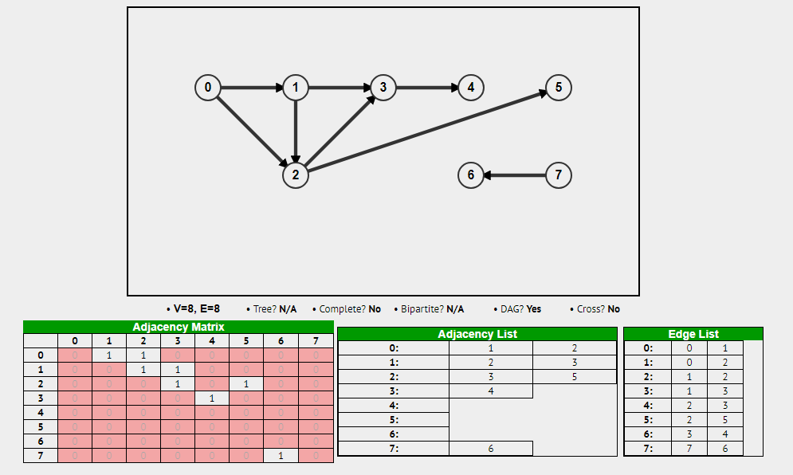
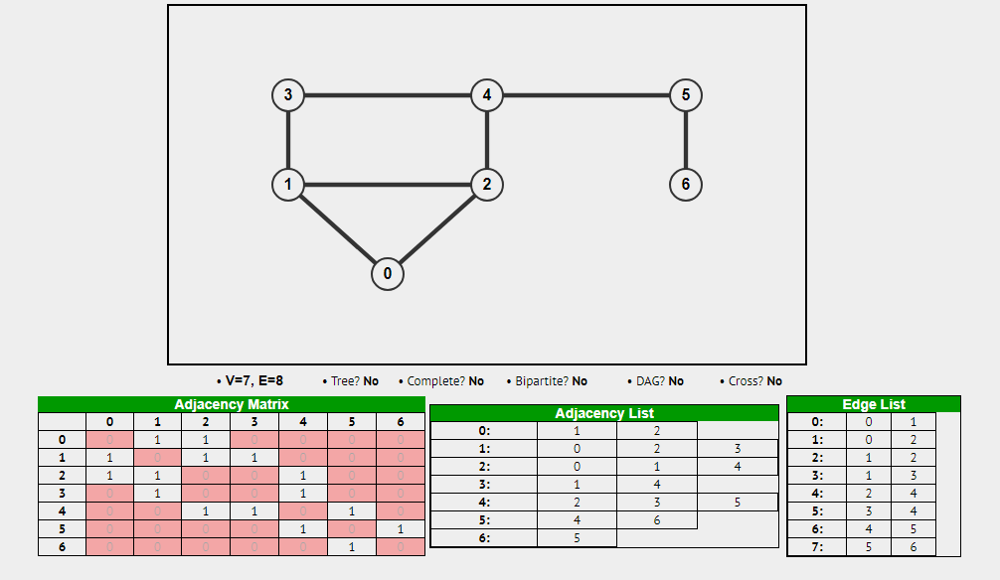
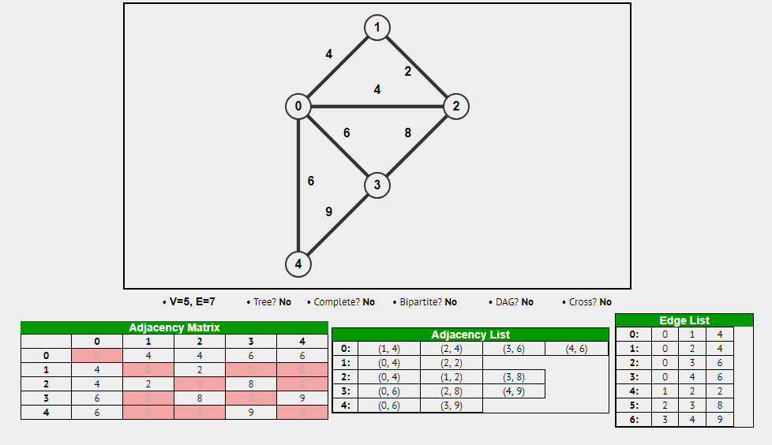
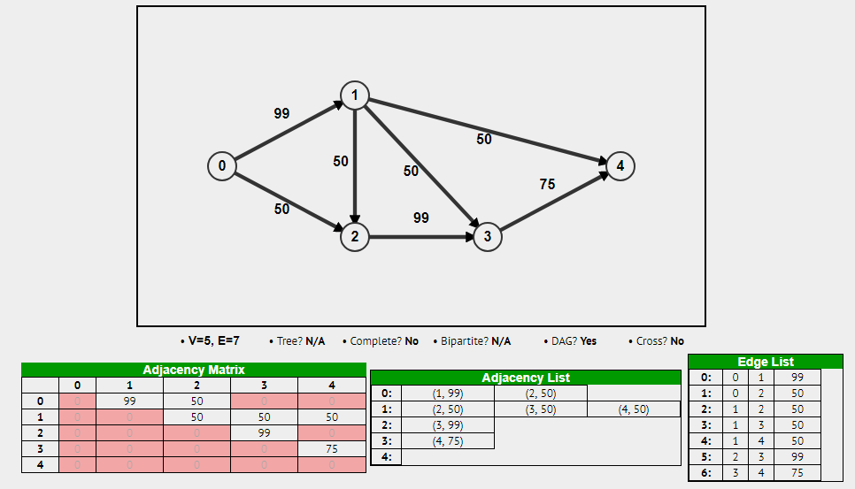

# Graph Fundamentals and Representations

---

# Overview

- Distinguish directed, undirected, and weighted graphs
- Describe vertices, edges, and paths
- Compare adjacency matrices, adjacency lists, and edge lists

---

# What is a graph?

A collection of vertices and edges

Recursive definition!
- A subgraph of a graph is a graph

A tree is a specific type of graph

---

# Types of graphs

- Directed vs undirected
- Weighted vs unweighted
- All variations include
  - Directed, Weighted
  - Directed, Unweighted
  - Undirected, Weighted
  - Undirected, Unweighted

---

# Graph Examples

[https://visualgo.net/en/graphds?slide=1](https://visualgo.net/en/graphds?slide=1)

---

# What is a path?

A path is a sequence of edges/vertices

---

# Graph Implementation

[https://www.geeksforgeeks.org/graph-and-its-representations/](https://www.geeksforgeeks.org/graph-and-its-representations/)

---

# Graph Illustration

---

# Graph Illustration

---

# Graph Illustration

---

# Graph Illustration

---

# Implementation Details

Yep - We still only have arrays and linked nodes!

---

# Implementation Details

We still only have arrays and linked nodes!

- Adjacency Matrix
  - 2D array (N x N, where N is number of nodes)
- Adjacency List
  - Array of Linked Nodes
- Edge List
  - 2D array (N x 2, where N is number of edges) or (N x 3 for weighted, where N is number of edges)

---

# Pros and Cons?

- Still the same!!!
- Consider
  - Memory overhead
  - Random access
  - mutability

---

# Summary

- Graphs model relationships using vertices and edges
- Direction and weights add information to connections
- Matrices, adjacency lists, and edge lists store the same relationships differently
- Representation choices affect memory and operation costs
