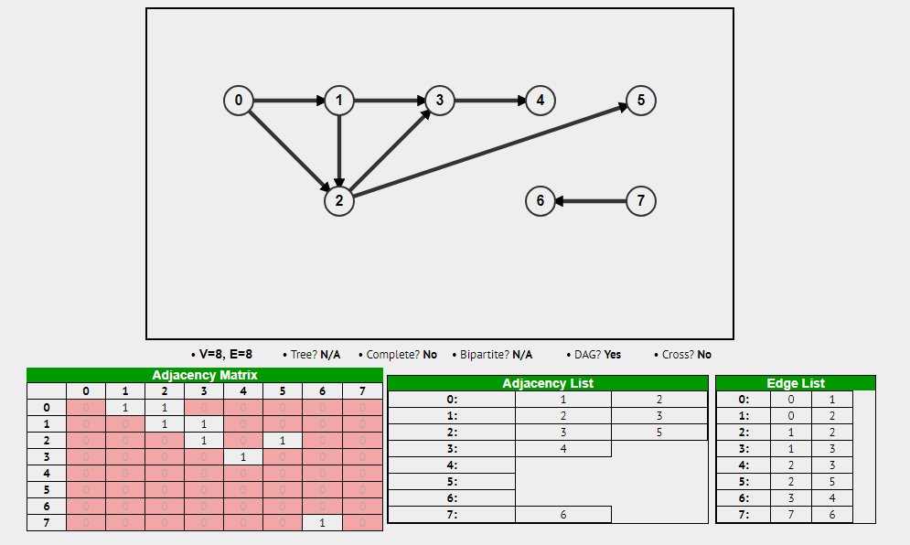
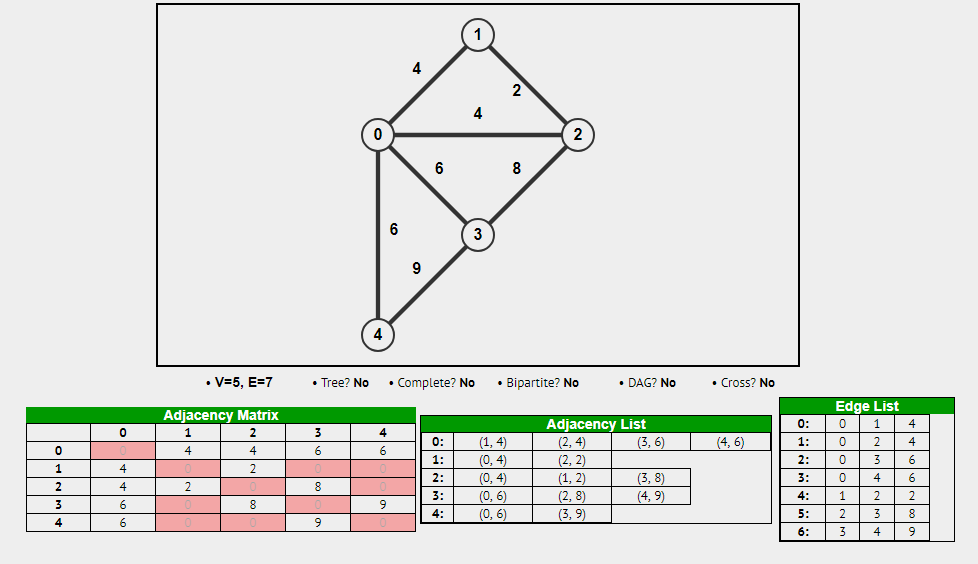
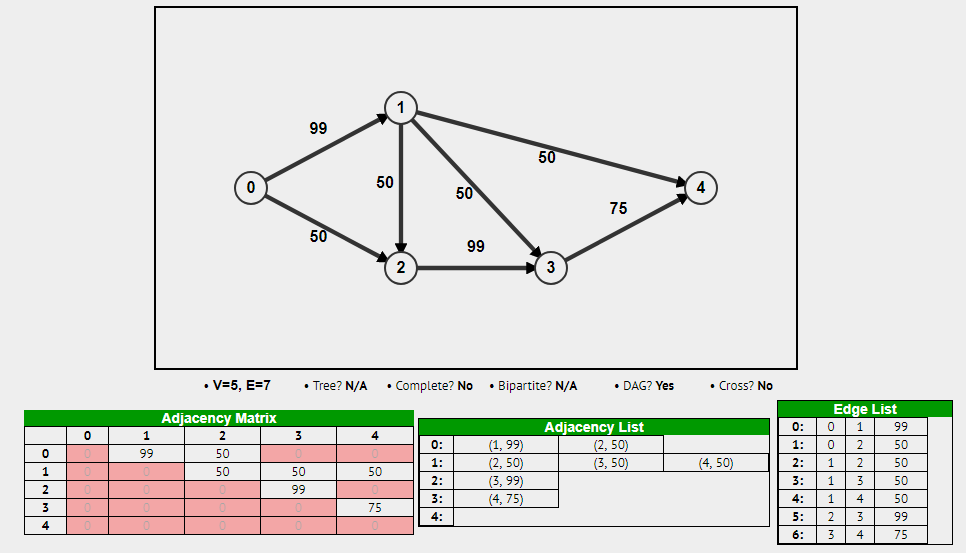

# Graph Fundamentals and Representations

---

# Overview

- Distinguish directed, undirected, and weighted graphs
- Describe vertices, edges, and paths
- Compare adjacency matrices, adjacency lists, and edge lists

---

# What is a graph?

A collection of vertices and edges

Recursive definition!
- A subgraph of a graph is a graph

A tree is a specific type of graph

---

# Types of graphs

- Directed vs undirected
- Weighted vs unweighted
- All variations include
  - Directed, Weighted
  - Directed, Unweighted
  - Undirected, Weighted
  - Undirected, Unweighted

---

# Graph Examples

[https://visualgo.net/en/graphds?slide=1](https://visualgo.net/en/graphds?slide=1)

---

# What is a path?

A path follows edges from one vertex to the next.

- If the graph has `A → B` and `B → C`, then `A → B → C` is a path of two edges.
- Two vertices are adjacent when a single edge joins them in the specified direction.
- In a directed graph, follow each edge in its stored direction.

---

# Graph Implementation

[https://www.geeksforgeeks.org/graph-and-its-representations/](https://www.geeksforgeeks.org/graph-and-its-representations/)

---

# Graph Illustration



---

# Graph Illustration


---

# Graph Illustration



---

# Graph Illustration



---

# Implementation Details

# Implementation Details

Let `V` be the number of vertices and `E` the number of edges.

- Adjacency Matrix
  - `V × V` array with a row for the source and a column for the destination
- Adjacency List
  - One list per vertex storing its outgoing neighbors
- Edge List
  - One row per edge storing its endpoints and, for a weighted graph, its weight

---

# Checking for a direct edge

For a directed, unweighted graph, assume `from` and `to` are valid vertices.

```java
// boolean[][] edges, indexed by vertex number
return edges[from][to];
```

```java
// Map<Integer, List<Integer>> neighbors,
// with one outgoing-neighbor list per vertex
return neighbors.get(from).contains(to);
```

Either return statement can implement `isConnected(from, to)` when its contract is to check for a direct edge.

---

# Storing an undirected edge

- Matrix: set both `edges[a][b]` and `edges[b][a]`.
- Adjacency list: add `b` to `a`'s list and `a` to `b`'s list.
- Edge list: store the pair once and check for the pair in either order when looking up the edge.

---

# Representation trade-offs

| Representation | Space | Check for a direct edge |
| --- | --- | --- |
| Adjacency matrix | O(V²) | O(1) with vertex indices |
| Array of adjacency lists | O(V + E) | Scan the source's list |
| Unsorted edge list | O(E) for edge records | Scan up to E edges |

An adjacency list makes it easy to iterate over the neighbors of a vertex. A matrix makes repeated direct-edge checks fast, with a cell for every possible pair.

---

# Summary

- Graphs model relationships using vertices and edges
- Direction and weights add information to connections
- Matrices, adjacency lists, and edge lists store the same relationships differently
- Representation choices affect memory and operation costs
