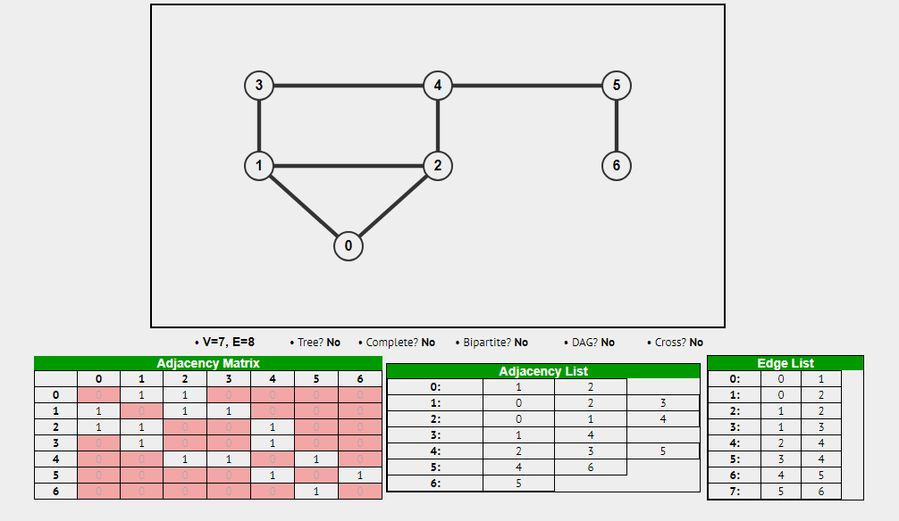

# Graph Fundamentals and Representations

---

# Overview

- Distinguish directed, undirected, and weighted graphs
- Describe vertices, edges, degree, paths, cycles, and connectivity
- Compare adjacency matrices, adjacency lists, and edge lists

---

# What is a graph?

A graph `G = (V, E)` consists of a set of vertices and a set of edges.

- A **vertex** (or node) represents an entity.
- An **edge** connects two vertices, such as a road between intersections.
- A **subgraph** uses some or all of the original vertices and edges. Each retained edge has both endpoints in the subgraph.

---

# Why use the Graph ADT?

A graph models **connections** between entities. The application decides which connections to follow and what to compute from them.

| Application | What the graph represents | What we can ask |
| --- | --- | --- |
| Road navigation | Intersections connected by roads | Which route takes the least time? |
| Course planning | Courses connected by prerequisite links | What must I complete before taking this course? |
| Social networks | People connected by friendships | Which friends do two people have in common? |
| Network design | Sites connected by possible cable links | How can we connect every site at the lowest total cost? |

The same graph can support several tasks. On a road map, you can list nearby intersections, check whether a destination is reachable, or find the fastest route.

---

# Contrast with other data structures

Many structures we studied are organized around particular operations or access rules.

| Structure | Operations and access rules |
| --- | --- |
| Stack | Push, pop, and peek at the most recently added item (LIFO). |
| Queue | Enqueue at the back and dequeue from the front (FIFO). |
| Binary search tree | Use key ordering to guide search, insertion, and removal. |
| Heap | Peek at or remove the minimum or maximum, and restore heap order after updates. |

The Graph ADT provides operations such as adding an edge or retrieving neighbors. The same connections can then support different algorithms, depending on whether the problem calls for reachability, a shortest route, or a minimum-cost network.

---

# Types of graphs

- **Directed:** `A -> B` goes from `A` to `B`. A reverse edge can be stored separately.
- **Undirected:** an edge connects its two endpoints in both directions.
- **Weighted:** each edge carries a value such as cost, distance, or time.
- **Unweighted:** path length is measured in edges.

Direction and weights are independent choices.

---

# Graph Examples

[https://visualgo.net/en/graphds?slide=1](https://visualgo.net/en/graphds?slide=1)

---

# Adjacency, paths, and reachability

- Two vertices are **adjacent** when a single edge joins them in the requested direction.
- A **simple path** follows edges without repeating vertices. Its length is the number of edges.
- A vertex is **reachable** from a source when a path leads from the source to it.

With just `A -> B` and `B -> C`, `C` is reachable from `A` in two edges, and `B` is the only outgoing neighbor of `A`.

---

# Cycles

A **cycle** follows one or more edges back to the starting vertex. It uses each edge once and repeats only the starting vertex.

- `A -> B -> C -> A` is a directed cycle when all three arrows exist.
- In an undirected graph, going out and back along the same edge does not form a cycle.
- An **acyclic** graph has no cycles. A **DAG** is a directed acyclic graph.
- An undirected **tree** is connected and acyclic. A **forest** is an undirected acyclic graph.

---

# Connectivity

- An undirected graph is **connected** when every pair of vertices has a path between them.
- A **connected component** is a maximal group of mutually reachable vertices in an undirected graph. An isolated vertex forms its own component.
- A directed graph is **strongly connected** when every vertex can reach every other vertex by following the arrows.
- It is **weakly connected** when it is connected after ignoring arrow directions. For example, `A -> B -> C` is weakly connected, and `C` cannot reach `A`.

---

# Graph Implementation

[https://www.geeksforgeeks.org/graph-and-its-representations/](https://www.geeksforgeeks.org/graph-and-its-representations/)

---

# Graph Illustration


---

# Graph Illustration



---

# Graph Illustration


---

# Graph Illustration


---

# Implementation Details

Let `V` be the number of vertices and `E` the number of edges.

- Adjacency Matrix
  - `V × V` array with a row for the source and a column for the destination
- Adjacency List
  - One list per vertex storing its outgoing neighbors
- Edge List
  - One row per edge storing its endpoints and, for a weighted graph, its weight

We'll focus on **adjacency matrices** and **adjacency lists** because many graph operations start at a vertex and need to find its neighbors or check for a direct edge. An edge list may have to scan all edges for those operations. **Kruskal's algorithm** is an exception. It processes all edges in weight order, so a sorted edge list is a natural fit.

---

# Adjacency Matrix

- **Fixed capacity.** Each vertex needs a row and a column. If the graph outgrows the allocated capacity, create a larger matrix and copy the old entries.
- **Space for every pair.** A matrix sized for `V` vertices uses **O(V^2)** space, even when the graph has few edges.
- **Check one neighbor.** With the vertex indices known, read `edges[from][to]` in **O(1)** time.
- **List all neighbors.** Scan all **V** cells in the source's row in **O(V)** time.

---

# Adjacency List with an Array of Linked Lists

Use one array slot per vertex. Each slot holds a linked list of that vertex's outgoing neighbors.

```text
0: 1 -> 2
1: (empty)
2: 1
```

- **Direct indexing.** With vertices numbered `0` through `V - 1`, `neighbors[from]` finds the source's list in **O(1)** time.
- **Flexible edge storage.** Add an edge by inserting a node in the source's list. The lists can grow independently. Adding vertices beyond the array's capacity requires a larger array.
- **Space for existing edges.** The array and its lists use **O(V + E)** space.
- **Check one neighbor.** Find the source's list by index, then follow links until you find `to` or reach the end.
- **List all neighbors.** Follow the links in the source's list to visit every outgoing neighbor.

---

# Adjacency Matrix with a Map of Maps

A `Map<Integer, Map<Integer, Integer>>` stores a row for each source vertex. Each row maps a destination ID to its edge weight. Give every vertex a row, even if it has no outgoing edges.

- **Find the source row.** With a `HashMap`, `edges.get(from)` typically takes **O(1)** time.
- **Flexible growth.** Vertex IDs can be nonconsecutive. Add a vertex with an empty row and insert new edges into the appropriate rows.
- **Space for existing edges.** Storing only existing edges uses **O(V + E)** space. Hash maps add per-entry overhead, so a two-dimensional array is often more compact when most pairs are connected.
- **Check one neighbor.** With a `HashMap` at both levels, `edges.get(from).containsKey(to)` typically takes **O(1)** time for valid vertices and requires no iteration.
- **List all neighbors.** Iterate over the entries in the source's row to visit its outgoing neighbors. A hash map does not guarantee their order.

---

# Adjacency List with a Map of Lists

A `HashMap<Integer, List<Integer>>` uses each vertex ID as the key for its outgoing-neighbor list.

- **Direct key lookup.** `neighbors.get(from)` typically finds the source's list in **O(1)** time. IDs like `10`, `42`, and `900` work as keys without assigning consecutive indices.
- **Flexible growth.** Add a vertex by inserting a key with an empty neighbor list. The map grows as needed.
- **Space for actual edges.** One list per vertex plus entries for existing neighbors uses **O(V + E)** space, which is useful for sparse graphs.
- **Check one neighbor.** Find the source's list by key, then call `contains(to)`. An unsorted list may require a full scan.
- **List all neighbors.** Iterate through the source's list to visit every outgoing neighbor.

---

# Checking for a direct edge

For a directed, unweighted graph, assume `from` and `to` are valid vertices.

**Adjacency matrix**

```java
// boolean[][] edges, indexed by vertex number
return edges[from][to];
```

**Adjacency list backed by a map**

```java
// Map<Integer, List<Integer>> neighbors,
// with one outgoing-neighbor list per vertex
return neighbors.get(from).contains(to);
```

Either return statement can implement `isConnected(from, to)` when it checks for a direct edge.

---

# Storing an undirected edge

- Matrix: set both `edges[a][b]` and `edges[b][a]`.
- Adjacency list: add `b` to `a`'s list and `a` to `b`'s list.
- Edge list: store the pair once and check for the pair in either order when looking up the edge.

---

# Representation trade-offs

A **sparse** graph contains relatively few of the possible edges. A **dense** graph contains many of them.

| Representation | Space | Check for a direct edge |
| --- | --- | --- |
| Adjacency matrix | O(V^2) | O(1) with vertex indices |
| Array of adjacency lists | O(V + E) | Scan the source's list |
| Unsorted edge list | O(E) for edge records | Scan up to E edges |

An adjacency list makes it easy to iterate over actual neighbors. A matrix makes repeated direct-edge checks fast. In a weighted matrix, reserve a distinct value for a missing edge because zero can be a valid weight.

---

# Summary

- Graphs model relationships using vertices and edges
- Direction and weights add information to connections
- Matrices, adjacency lists, and edge lists store the same relationships differently
- Representation choices affect memory and operation costs
