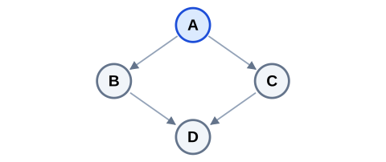
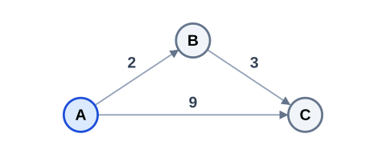

# Graph Traversal and Shortest Paths

---

# Overview

- Trace breadth-first and depth-first search
- Connect queues and stacks to traversal order
- Distinguish traversal paths from weighted shortest paths
- Explore Dijkstra distance updates

---

# Why mark vertices as visited?

A cycle can lead a traversal back to a vertex it has already seen.

```text
A -> B -> C -> A
```

- Start at `A`. Following each edge without tracking visits can repeat `A, B, C` indefinitely.
- Mark `A` as soon as it is discovered. When the traversal reaches `C` and sees the edge back to `A`, it skips `A`.
- Keep a shared set of discovered vertices for the whole traversal. This also prevents duplicate work when two branches lead to the same vertex.

---

# DFS and BFS

- Breadth-first search (BFS) explores vertices in order of distance from the start, measured in edges.
- Depth-first search (DFS) follows one branch as far as it can before backtracking.
- Both track discovered vertices to handle cycles and converging paths.

---

# BFS explores by layers

- Start at distance 0. Discover all vertices one edge away before exploring vertices two edges away.
- Each layer groups vertices by their distance from the source, measured in edges.
- On an unweighted subway map, BFS finds a route with the fewest links between stations. The fastest route may depend on travel times.



Start at `A` and consider `B` before `C`.

---

# BFS Algorithm

1. Mark the start vertex as discovered and enqueue it.
2. Dequeue a vertex and examine its outgoing neighbors.
3. For each undiscovered neighbor, mark it as discovered and enqueue it.
4. Repeat until the queue is empty. This visits every vertex reachable from the start.

Marking a vertex when it enters the queue keeps two neighbors from enqueueing it twice.

---

# BFS in Java

Here and in DFS, `map` is a `Map<T, List<T>>` with an outgoing list for every vertex. The source is a valid vertex.

```java
void breadthFirstSearch(T source) {
    HashMap<T, Boolean> visited = new HashMap<>();
    Queue<T> queue = new LinkedList<>();
    visited.put(source, true);
    queue.add(source);

    while (!queue.isEmpty()) {
        T current = queue.remove();
        System.out.println(current);
        for (T next : map.get(current)) {
            if (visited.putIfAbsent(next, true) == null) {
                queue.add(next);
            }
        }
    }
}
```

Mark each vertex when it enters the queue so it is queued once.

---

# Trace the BFS queue

The queue is FIFO, with the front on the left. Mark a vertex visited when it is enqueued.

| Vertex processed | Newly discovered | Queue after processing | Visited nodes |
| --- | --- | --- | --- |
| Start | A | A | A |
| A | B, C | B, C | A, B, C |
| B | D | C, D | A, B, C, D |
| C | None. D is already discovered. | D | A, B, C, D |
| D | None | Empty | A, B, C, D |

BFS processes **A, B, C, D**. Marking `D` when it enters the queue lets us skip the second discovery through `C`.

---

# DFS follows a branch


Start at `A` and consider `B` before `C`. DFS follows the branch through `B` as far as it can, then backtracks to explore `C`.

---

# DFS uses a stack

Recursion uses the call stack to remember where to resume in each neighbor list.

```text
dfs(u):
    mark u as discovered
    process u
    for each outgoing neighbor v of u:
        if v is undiscovered:
            dfs(v)
```

An iterative DFS can keep the current vertex and its next neighbor on an explicit stack. Popping that frame is equivalent to returning from a recursive call.

---

# Iterative DFS in Java

```java
void depthFirstSearch(T source) {
    HashMap<T, Boolean> visited = new HashMap<>();
    Stack<T> stack = new Stack<>();
    stack.push(source);

    while (!stack.isEmpty()) {
        T current = stack.pop();
        if (visited.putIfAbsent(current, true) != null) {
            continue;
        }
        System.out.println(current);
        List<T> neighbors = map.get(current);
        ListIterator<T> it = neighbors.listIterator(neighbors.size());
        while (it.hasPrevious()) {
            T next = it.previous();
            if (!visited.containsKey(next)) {
                stack.push(next);
            }
        }
    }
}
```

Push neighbors in reverse order so the first listed neighbor is processed first. This version marks a vertex when it is popped. If another branch already processed it, skip the duplicate entry before expanding its neighbors.

---

# Trace the DFS stack

Use the same graph as BFS. The stack is LIFO, with the top on the left. Mark a vertex visited when it is first popped. Push neighbors in reverse order.

| Vertex processed | Neighbors pushed | Stack after processing | Visited nodes |
| --- | --- | --- | --- |
| Start | A | A | Empty |
| A | C, then B | B, C | A |
| B | D | D, C | A, B |
| D | None | C | A, B, D |
| C | None. D is already visited. | Empty | A, B, D, C |

DFS processes **A, B, D, C**. The stack puts `D` ahead of `C`, so DFS finishes the branch through `B` first.

---

# Traversing disconnected graphs

- From one source, BFS and DFS visit only the vertices reachable from it.
- To traverse an entire graph, scan its vertices and start a new search at each undiscovered vertex. Keep the same discovered set across searches.
- In an undirected graph, each new search visits one connected component.

---

# Reconstructing a path

- When a vertex is first discovered, record the vertex that led to it as its predecessor.
- To recover a path, follow predecessors backward from the destination to the source, then reverse the sequence.
- If the search finishes before discovering the destination, it is unreachable from the source.

---

# BFS versus DFS

| | BFS | DFS |
| --- | --- | --- |
| Worklist | Queue (FIFO) | Stack (LIFO) or recursion |
| Next vertex | Oldest pending vertex | Most recently pushed vertex |
| Search pattern | Explore one distance layer at a time | Follow a branch before backtracking |
| Path found | Fewest edges in an unweighted graph | A path determined by neighbor order |

On the same example, BFS visits **A, B, C, D** and DFS visits **A, B, D, C**. Both use a visited map to avoid processing a vertex twice.

---

# Fewest edges versus lowest cost

- **DFS** can find a route. The first route it finds depends on neighbor order.
- **BFS** finds a route with the fewest edges. This also minimizes total cost when all edges have the same positive cost.
- When edge weights differ, compare the **sum** of the weights along each route.



| Route | Edges | Total cost |
| --- | --- | --- |
| `A -> C` | 1 | 9 |
| `A -> B -> C` | 2 | 2 + 3 = 5 |

BFS prefers the first route by edge count. The second route has the lower total cost.

---

# What Dijkstra tracks

[Watch the Dijkstra's algorithm video](https://www.youtube.com/watch?v=pVfj6mxhdMw)

[Step through Dijkstra's algorithm interactively](https://www.cs.usfca.edu/~galles/visualization/Dijkstra.html)

Dijkstra finds minimum-cost paths from one source when every edge weight is nonnegative.

- **Tentative distance:** the best cost found so far. Start at 0 for the source and infinity for every other vertex.
- **Predecessor:** the vertex that led to the current best route. Update it whenever the tentative distance improves.

---

# Dijkstra vocabulary: Settle and relax

**Settle a vertex.** Finalize its shortest distance from the source. Dijkstra does this when the vertex has the smallest tentative distance among those still waiting.

**Relax an edge.** Test whether reaching the destination through that edge gives a cheaper route. If so, update the destination's cost and predecessor.

**Example.** Once `B` is settled at cost 2, relax `B -> C` (weight 3). The candidate cost is 5, so update `C` from 9 to 5.

---

# Settle a vertex and relax its edges

1. Remove the vertex `u` with the smallest tentative distance from the priority queue. Settle it.
2. For each outgoing edge `u -> v`, compute `distance[u] + weight(u, v)`. If that candidate is smaller than `distance[v]`, update the distance, predecessor, and queue.
3. Repeat while there are reachable unsettled vertices. If searching for one destination, stop when it is settled. Unreachable vertices keep distance infinity.

A negative edge could create a cheaper route after a vertex has already been settled. Dijkstra relies on nonnegative weights to rule that out.

---

# Trace Dijkstra from A

Use the three edges from the route example. Each row shows the distances after relaxing the outgoing edges of the vertex just settled.

| Just settled | Cost to A | Cost to B | Cost to C | Predecessor of C |
| --- | --- | --- | --- | --- |
| None | 0 | Infinity | Infinity | None |
| A | 0 | 2 | 9 | A |
| B | 0 | 2 | 5 | B |
| C | 0 | 2 | 5 | B |

The first route found to `C` costs 9. Relaxing `B -> C` lowers it to 5. Follow predecessors `C, B, A` backward and reverse them to get `A -> B -> C`.

---

# Dijkstra's final results

A full run of Dijkstra's algorithm computes the shortest cost from the source to **every vertex**. Unreachable vertices keep a cost of infinity and have no predecessor.

| Node | Shortest cost from A | Predecessor |
| --- | --- | --- |
| A | 0 | None (source) |
| B | 2 | A |
| C | 5 | B |

To recover the shortest path to any reachable node, follow its predecessors back to the source, then reverse that sequence. For `C`, follow `C -> B -> A` backward to get **A -> B -> C**, with total cost **5**.

---

# Time complexity

Let `V` be the number of vertices and `E` the number of edges.

| Algorithm and representation | Worst-case time | Work |
| --- | --- | --- |
| BFS or DFS, adjacency lists | O(V + E) | Visit vertices and examine their stored neighbors. |
| BFS or DFS, adjacency matrix | O(V^2) | Scan a row of V cells for each processed vertex. |
| Dijkstra, adjacency lists and a binary heap | O((V + E) log V) | Examine edges and maintain tentative distances in the heap. |

---

# Summary

- BFS explores nearby vertices first using a queue
- DFS explores a branch before backtracking using a stack or recursion
- Visited tracking prevents repeatedly processing vertices
- BFS finds shortest paths by edge count in unweighted graphs
- Dijkstra uses distance updates for graphs with nonnegative edge weights
