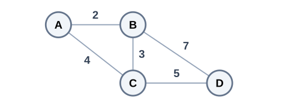
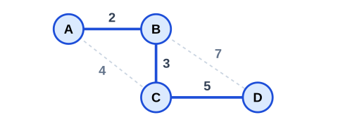

# Minimum Spanning Trees and Course Review

---

# Overview

- Distinguish connectivity and cycles
- Compare Kruskal and Prim strategies
- Review ADTs and their underlying implementations

---

# Minimum spanning trees

- A **spanning tree** uses all the vertices of a connected, undirected graph and enough of its original edges to connect them without cycles.
- A spanning tree on `V` vertices has exactly `V - 1` edges.
- A **minimum spanning tree** (MST) minimizes the sum of the selected edge weights. Ties can produce more than one MST.

---

# Why use a minimum spanning tree?

Use an MST when **every site needs a connection** and the goal is to minimize the **total cost of the links you build**.

- **Campus networking:** connect all buildings while minimizing cable installation cost.
- **Utilities:** connect facilities through candidate routes whose costs vary by distance or terrain.
- **Network planning:** use the minimum-cost tree as a baseline, then decide where backup links are worth the extra cost.

A spanning tree gives exactly one route between any two sites. Losing one link splits the tree, so networks that need backup routes require additional links.

---

# A network design example

Four sites need to be connected. Each edge weight is the cost of installing one link. Which links connect all four sites at the lowest total cost?

A spanning tree needs three links for these four sites. There can be several possible sets of three links.

---

# Why avoid cycles?

- A tree has exactly one simple path between any pair of vertices.
- Adding an edge between two vertices already connected in a tree creates a cycle.
- Removing one edge from a cycle preserves connectivity because the rest of the cycle supplies another route.
- A disconnected graph has no spanning tree covering all its vertices. A **minimum spanning forest** contains an MST for each connected component.

---

# Why choose the cheapest crossing edge?

Split the vertices into two groups. An edge that joins the groups is a **crossing edge**. A spanning tree needs at least one crossing edge.

- Take a cheapest crossing edge. If an MST already contains it, we can keep it.
- Otherwise, add it to an MST. This creates a cycle with another crossing edge on it.
- Remove that other crossing edge. The result is still a spanning tree, and its cost cannot increase because the edge we added was cheapest.

This is the **cut property**. In Kruskal, one side can be a current component. In Prim, one side is the growing tree.

---

# Kruskal's algorithm

[Watch the Kruskal's algorithm video](https://www.youtube.com/watch?v=71UQH7Pr9kU)

1. Start with every vertex in its own component.
2. Consider edges in increasing weight order. Accept an edge if it joins two different components, then merge those components.
3. Stop after accepting `V - 1` edges in a connected graph. A disjoint-set structure (union-find) can track the components.

**Why use an edge list?** Kruskal is the first algorithm in this module that benefits from starting with an edge list. Store each undirected edge once as `(from, to, weight)` and sort the list by weight. Kruskal can then scan it in order and use union-find to decide which edges to accept.

---

# Trace Kruskal

Process all edges in increasing order of weight.

| Edge | Cost | Decision | Components after the decision |
| --- | --- | --- | --- |
| A-B | 2 | Accept | {A, B}, {C}, {D} |
| B-C | 3 | Accept | {A, B, C}, {D} |
| A-C | 4 | Skip. A and C are already connected. | {A, B, C}, {D} |
| C-D | 5 | Accept | {A, B, C, D} |

Stop after three accepted edges. The total cost is **2 + 3 + 5 = 10**.

---

# Prim's algorithm

[Watch the Prim's algorithm video](https://www.youtube.com/watch?v=cplfcGZmX7I)

1. Start with any vertex.
2. Choose the lightest edge from a vertex already in the growing tree to a vertex outside it.
3. Add the edge and its outside vertex. Repeat until all vertices are included.

---

# Trace Prim from D

At each step, look only at the edges that connect a vertex in the tree to a vertex outside it.

| Vertices in the tree | Eligible edges (cost) | Choose |
| --- | --- | --- |
| {D} | C-D (5), B-D (7) | C-D (5) |
| {C, D} | B-C (3), A-C (4), B-D (7) | B-C (3) |
| {B, C, D} | A-B (2), A-C (4) | A-B (2) |

Prim finds the same tree as Kruskal here. Its chosen costs are 5, 3, and 2 because eligibility changes as the tree grows.

---

# Compare the results

- **Kruskal** joins separate components using the cheapest eligible edges across the graph.
- **Prim** grows one tree using the cheapest edge from that tree to a new vertex.
- Both find a tree with minimum total weight. If weights tie, they can return different trees with the same minimum cost.

---

# MST versus shortest paths

- In the example MST, traveling from `A` to `C` follows `A-B-C` and costs **2 + 3 = 5**.
- In the original graph, the direct `A-C` edge costs **4**. It gives the shortest route from `A` to `C`.
- An MST minimizes the total cost of the network. A shortest-path algorithm minimizes the cost of a route from a source.

---

# Interactive MST visualization

[Step through Prim's and Kruskal's algorithms on VisuAlgo](https://visualgo.net/en/mst?slide=1)

---

# Semester Summary

<!-- column -->

## ADTs

- List
- Stack
- Queue
- Deque
- Set
- Map
- Trees (General, Binary, BST, AVL, Heap)
- Graphs (directed, undirected, weighted, unweighted, cyclic, acyclic)

<!-- column -->

## Implementations

- Array
- SLL
- Circular Array
- DLL
- Circular SLL
- Circular DLL
- Hash Table
- Open hashing
- Closed hashing
- Arrays of Linked Lists

---

# Course review: choose the structure

| Task | Structure and operation |
| --- | --- |
| Process requests in arrival order | Queue. Remove the oldest request first. |
| Undo the most recent action | Stack. Pop the latest action. |
| Retrieve a value by key | Map. Look up the key in a hash table or another map implementation. |
| Repeatedly take the smallest priority | Min-heap. Remove the minimum and restore heap order. |
| Connect sites at minimum total cost | Weighted graph. Use Prim or Kruskal to find an MST. |

Name the operations the application needs, then choose a representation that supports them efficiently.

---

# Summary

- A spanning tree connects all vertices without cycles
- An MST minimizes total edge weight in a connected undirected weighted graph
- Kruskal adds low-weight edges while avoiding cycles
- Prim grows a tree by connecting it to a new vertex
- ADTs describe behavior; representations determine implementation tradeoffs
